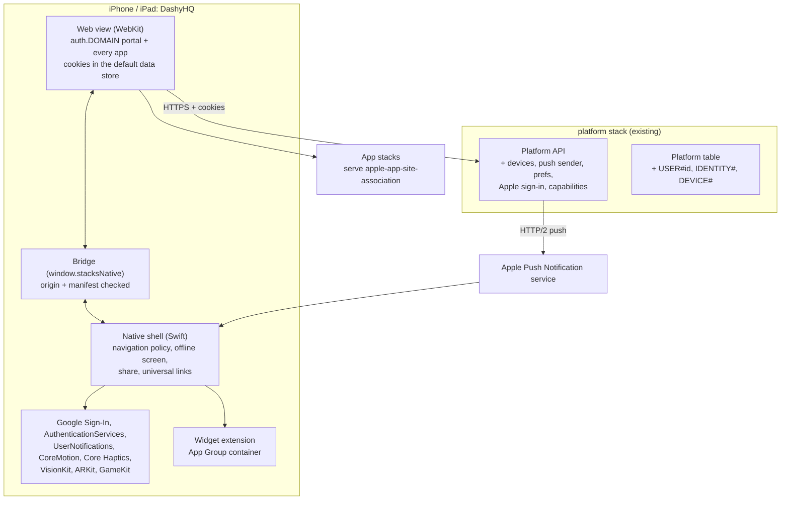
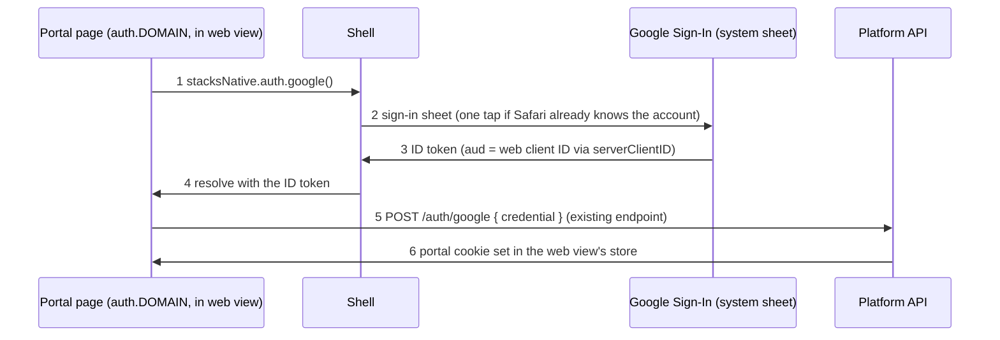

# Stacks — Native App Spec (iOS and iPadOS)

As of 2026-11-09 · Owner: Dashiell Nash (@dashnash) · Status: draft from the brainstorm, nothing built

> This spec adds a native iOS/iPadOS app to the platform described in `docs/PLATFORM_SPEC.md`.
> Read that first. Where this spec changes a platform decision (identity, notifications, manifest),
> the change lands in `PLATFORM_SPEC.md` in the same PR as the code.

## Overview

**DashyHQ** is one universal iPhone/iPad app that wraps the whole Stacks platform: it opens the
portal at `auth.<domain>`, and every app on the platform runs inside it from the live website.
The native code is a thin shell. It adds only what the web can't do on iOS: system sign-in with
Google and Apple, APNs push and badges, universal links, the share sheet, and a capability bridge to
device hardware (haptics, motion, camera, AR, Game Center, widgets). New apps and every content
change reach the app with no iOS release. A shell release is needed only when the shell itself
changes.

**Goals**

1. **Thin shell.** All product UI stays on the web. The shell never renders an app's own screens,
   and a new Stacks app needs no iOS work.
2. **One-tap sign-in** with the Google account already signed in on the device (through
   Safari/Google's iOS sign-in), and Sign in with Apple, on iOS and the web.
3. **iOS notifications.** Every inbox notification also arrives as a push, the icon badge shows the
   inbox count, apps can be muted, and access requests can be approved from the lock screen.
4. **Hardware for apps.** Motion games and camera apps through a safe, declared, tested bridge that
   falls back to web standards in Safari and in demo mode.
5. **Shipped by GitHub Actions** to TestFlight now and the App Store later. Sessions never hold
   Apple or AWS credentials.
6. **Learn the iOS publishing path** end to end (an explicit goal: the one-time setup steps are
   written as a runbook, not hidden in automation).

**Non-goals for v1**: per-app branded iOS apps (one DashyHQ app only; the shell stays able to
produce them later), Android (the bridge protocol stays platform-neutral so it can be added later),
offline use of app content, native rewrites of any app screen, Live Activities, NFC, HealthKit,
background location.

## Decisions log

From the brainstorm on 2026-11-09.

| Area | Decision |
| --- | --- |
| Why native | Learn iOS publishing, App Store presence, native sign-in, reliable push. Web Push for Home Screen web apps was considered and is not the plan; it may come later for desktop browsers on the same device registry |
| Distribution | TestFlight first; designed to the App Store bar so a public listing follows |
| Scope | One universal app for the whole platform (iPhone + iPad) |
| Name / bundle ID | App name **DashyHQ** / `com.dashyhq.stacks`; staging **DashyHQ Test** / `com.dashyhq.stacks.test` |
| Apple account | Paid individual Developer Program membership, active (seller shows as Dashiell Nash). Covers TestFlight, CI uploads, push, Sign in with Apple and universal links |
| Minimum OS | iOS/iPadOS 26 |
| Staging app | Yes: a second app on `*.test.<domain>`, own bundle ID, TestFlight internal testers only |
| Shell model | A `WKWebView` (or SwiftUI `WebView`/`WebPage` where it exposes the hooks we need) loading the live site; no bundled web content except the offline screen |
| Google sign-in | Native Google Sign-In for iOS (Google blocks OAuth in embedded web views); the ID token goes to the existing `POST /auth/google` from inside the web view |
| Apple sign-in | **Added to the platform**, web and iOS. Lifts the platform's "non-Google identity providers" non-goal |
| User identity | **Users move from email keys to internal user IDs** in one coordinated cut-over across the platform and every app table |
| Account merge | Self-serve, from Settings; the merged-away ID becomes an alias, so app data needs no rewrite |
| Email to apps | None by default; Book Club doesn't need member emails (its admin page and meeting form switch to display names) |
| Push | Every inbox notification is pushed; badge = inbox count; per-app mute; Approve/Deny on access requests |
| Push transport | APNs directly from the Platform API Lambda (HTTP/2, token auth with a `.p8` key in SSM); no SNS |
| Native extras v1 | Universal links, native share sheet, offline/error screen with pull-to-refresh |
| Hardware | Game kit, Camera kit, AR, Game Center, location, microphone/audio, Home Screen widgets |
| Capability gating | Declared in the app's manifest; adding a sensitive one needs `CODEOWNERS` review; the shell refuses undeclared calls; iOS still prompts the user |
| Bridge principle | Web standards first; a native bridge call only where WebKit on iOS falls short |
| Bridge protocol | Versioned, platform-neutral JSON messages (Android could implement them later) |
| Dev machine | Dash has a Mac with Xcode (local simulator and device debugging); CI does signing and uploads |
| CI | macOS runner on merge to `main` touching the shell, plus manual dispatch and a monthly rebuild; PRs touching the shell build and test unsigned |
| Project file | Generated from a text spec (XcodeGen `project.yml`), so it is reviewable and editable from Linux sessions |

## Architecture



- The shell holds **no Stacks session of its own**. The web view's cookies (`__Host-stacks-portal` on
  `auth.<domain>`, each app's `__Host-stacks-session`) are the sessions, exactly as in Safari. Silent
  sign-in across subdomains already works in Safari, and WebKit applies the same rules here.
- The **only native credential** is a per-device secret used to act on push notifications (Approve
  or Deny) without opening the web view. See Notifications.
- **Root domain is baked into the build** (start URL, associated domains, allowed hosts). Changing
  `rootDomain` in `stacks.config.json` needs a shell release. CI reads the domains from
  `stacks.config.json` at build time, so there is one source of truth.

### Repo layout additions

```
native/
  protocol/                 # bridge message JSON Schemas + fixtures (shared by TS and Swift tests)
  ios/
    project.yml             # XcodeGen spec: targets, configs, entitlements, Info.plist keys
    VERSION                 # marketing version (1.0.0); build number = CI run number
    Shell/                  # app target: web view, navigation, bridge, sign-in, push, share
    Capabilities/           # one file per capability (Haptics, Motion, Camera, Scan, AR, GameCenter, ...)
    Widget/                 # WidgetKit extension
    Tests/                  # XCTest: bridge routing, origin checks, URL policy, protocol fixtures
    UITests/                # XCUITest smoke against the portal's demo build
packages/native/            # @stacks/native: typed bridge client, web fallbacks, demo fakes, README
.github/workflows/ios.yml
docs/IOS_SETUP.md           # one-time Apple/Google setup runbook (learning goal)
```

`native/` and `packages/native/` are platform code, owned by `@dashnash` in `CODEOWNERS`. Apps
import only `@stacks/native`, never `native/`.

## Shell behaviour

| Concern | Rule |
| --- | --- |
| Start page | `https://auth.<domain>/`, or the page the person was on at last launch (restored within 24 h) |
| In-app hosts | `auth.<domain>`, the bare domain and any `*.<domain>`, except another environment's root under it (production skips `*.test.<domain>`). A new app works in the app the moment it deploys. `/native/config` is fetched at launch for the update check |
| Other links | Open in `SFSafariViewController` (Google, GitHub, external sites); `mailto:`/`tel:`/`sms:` go to the system |
| Identity | User agent gains `DashyHQ/<version> StacksNative/<protocol>` so pages can tell they're in the shell; `window.stacksNative` is injected at document start |
| Chrome | Full-bleed web view, safe-area aware, no native tab bar. The account menu stays the only navigation (the platform's rule), so iPad Split View, Stage Manager and rotation just work |
| Back | Edge-swipe back on; apps can turn it off during a game (Game kit) |
| Offline / errors | A native screen ("Can't reach Stacks", retry, last-tried URL) for network failures and 5xx on the main frame; pull-to-refresh on every page |
| Downloads and files | `<input type=file>` uses the system picker and camera; downloads go to the share sheet |
| Universal links | `applinks:auth.<domain>` and `applinks:*.<domain>`; opening any link to these hosts lands on that page in the app |
| Share | `stacksNative.share({ url, text, title })` opens the share sheet; the web fallback is `navigator.share` |
| Updates | Content is always live. The shell checks a `minShellVersion` in the Platform API's `/native/config` and shows "Update DashyHQ" when the shell is too old for the current bridge |

**Universal links on the web side.** The portal's and every app's CloudFront router answer
`/.well-known/apple-app-site-association` themselves (JSON, no redirect, cached an hour), built from
the environment's `native` settings (Team ID + that environment's bundle ID), so every host serves it
with no file in S3 and no app code. Sign-in plumbing (`/api/*`, `/authorize`, `/logout`) stays in the
browser. Nothing is served until `appleTeamId` is set.

## Sign-in

### Google (native)

Google rejects OAuth inside embedded web views, so the portal's Google button can't run in the shell.



- The portal detects the shell and shows "Continue with Google" wired to the bridge instead of
  Google's web button. Apps already send sign-in through the portal, so they need no change.
- The shell sets `serverClientID` to the platform's web client ID, so the ID token's `aud` is the
  same one `verifyGoogle` checks today. `verifyGoogle` additionally accepts an `azp` from an
  allowlist of the iOS client IDs (config `googleIosClientIds` per environment).
- **The ID token is handed only to the main frame on `auth.<domain>`.** Any other origin calling
  `auth.*` gets `forbidden`: an app must never obtain someone's Google token.
- "The Google account set up in iOS Settings" isn't reachable: iOS gives third-party apps no access
  to system accounts. The system sheet, which shares Safari's Google session, is the closest
  equivalent.
- Sign-out (account menu) ends the platform sessions as today, then calls `stacksNative.auth.signedOut()`
  so the shell runs `GIDSignIn.signOut()`, removes this device's registration and clears the badge.

### Apple (web and iOS, new)

- **iOS**: `ASAuthorizationAppleIDProvider` in the shell, the same bridge pattern as Google
  (`stacksNative.auth.apple()` → identity token → `POST /auth/apple`).
- **Web**: Sign in with Apple JS on the portal, with an Apple **Services ID** for `auth.<domain>`
  (and `auth.test.<domain>`), domain verification, and a client-secret signing key in SSM.
- `POST /auth/apple` verifies the JWT against Apple's JWKS (issuer `https://appleid.apple.com`,
  audience = either bundle ID or the Services ID) and keys the identity by Apple's `sub`.
- Apple sends the name and email **only on the first authorization**. The portal stores them
  then. A hidden email arrives as a `@privaterelay.appleid.com` address.
- Apple's `sub` is stable per developer **team**. Moving the app from the individual account to an
  organization later needs Apple's Sign in with Apple user-migration step (transfer identifiers).
  This is recorded as a one-way-door risk.
- Required for the App Store under guideline 4.8 when Google sign-in is offered; TestFlight
  does not require it but it ships before the first public submission.

## Identity v2: internal user IDs (platform change)

Today a user is `USER#<email>`, grants are keyed by email, and apps store emails as authors, voters
and members. Apple's private relay emails would split one person into two, so identity moves to
an internal ID.

**Model**

| Entity | Key | Notes |
| --- | --- | --- |
| User | `USER#<userId>` | `userId` = `u_` + 26-char ULID. Holds `email` (primary contact), `name`, `displayName`, `pictureUrl`, prefs |
| Identity | `IDENTITY#google#<sub>`, `IDENTITY#apple#<sub>` → `userId` | Google is matched by `sub` from now on (today it is matched by email only, `platform/api/src/google.ts`) |
| Email index | `EMAIL#<email>` → `userId` | For `platformAdmins`, manifest `owners`, the grid search and migrations. Relay emails are indexed too |
| Grant | `APP#<slug>` / `USER#<userId>` | Unchanged shape, new key |
| App session | app table `SESSION#<sha>`, index `USERSESSIONS#<userId>` | |
| Notification | `NOTIF#<userId>` | |

**Matching at sign-in**: identity `sub` → user. Else a *verified, non-relay* email that matches a user → link
the new identity to that user automatically. Else a new user. Signed-in people can add the other
provider in **Settings › Sign-in methods** ("Link Apple ID" / "Link Google").

**Self-serve merge.** If the identity being linked already belongs to another account, Settings
offers **Merge accounts**: the person is signed in to account A and has just proved account B by
signing in with it, so both are theirs. They confirm a summary (B's apps and roles, what A keeps),
and then:

- B's identities and emails move to A; `USER#B` becomes `{ mergedInto: A }` (an **alias**, kept
  forever). A's profile wins; B's display name and avatar are dropped unless A has none.
- **Grants**, per app: a role beats pending or none; between two roles the one listed earlier in the
  manifest's `roles` wins (roles are listed strongest first, as every manifest does today); **`BLOCKED`
  on either side wins**, so a merge can't escape a block. Pending requests are kept once.
- **App data isn't rewritten.** Apps keep B's ID wherever they stored it. The platform gives A's
  `formerIds` (`[B, …]`) with A on sign-in and in member lists; `getPeople` resolves them, so B's old
  posts show as A, and apps compare stored ids with `isUser(user, id)` (comments and Book Club do), so
  A can still edit B's old comments, lead B's meeting and take back B's vote. A `user.merged` webhook
  for apps that want to rewrite their tables is deferred until one needs it.
- **Profile.** Each account has a primary identity (`primaryIdentity`): only its Google name, photo
  and email update the profile. Linked identities just sign in.
- B's sessions and devices end; inbox items move to A. Audit `user.merge` (both IDs) in the platform
  feed and in each app where B had a grant.
- Limits: you can't merge into or out of a platform admin from Settings (super-admin only), you
  can't merge an alias, and there's no unmerge (the summary says so).

**What apps see**: `user.id`, `displayName`, `pictureUrl` and their role. Email is no longer given to
apps by default. An app that truly needs it declares `"needsEmail": true` in its manifest
(reviewed like a sensitive capability: `scripts/pr-paths.mjs` marks a PR that turns it on as platform
work and refuses it on an app branch), and a relay address is what it gets for hidden-email users.
No app needs it today. Built in N1b: the platform leaves emails out of `/token` and `/access` for
apps without it, the SDK's test harness and demo do the same, the account menu shows an email only
when there is one, and `tools/app-conformance` fails an app that puts any persona's email on screen.
`deps.platform.notify(userId, …)`, `appMembers`, `getPeople` and the comments module all move to IDs.
`stacks.config.json` keeps `platformAdmins` and manifest `owners` as emails, resolved through `EMAIL#`.

**Cut-over (one coordinated migration, like the Book Club one)**

Runbook: `docs/USER_IDS_CUTOVER.md`.

1. Ship SDK and platform code that read and write IDs, plus `tools/migrate-user-ids`.
2. Every app that stored emails provides `apps/<slug>/api/migrations/user-ids.ts` (`migrate`, an
   `ItemMigration` composed from the SDK's, its modules' and its own); `hello`, `flippy-work-table`,
   `mofobookklub` and the comments module have one. New apps (and the template) need none: they never
   stored emails.
3. A `maintenance` flag per environment in `stacks.config.json` makes the platform and every app API
   answer 503 (except health checks) and their pages show "Back in a few minutes". The same PR turns
   it on, so the merge deploys straight into maintenance.
4. Dash runs the tool with admin credentials: `--dry-run` against both environments *before* merging
   (it only reads), then for real on staging, then production. It assigns IDs, writes the email index,
   rewrites grants, notifications and audit actors, gives grant holders who never signed in an account,
   runs every app's migration, and drops all sessions. Google identities (`IDENTITY#google#<sub>`) are
   linked on each person's next sign-in, by their verified email.
5. Lift maintenance. Everyone signs in once more.

Done when every existing user signs in with Google and sees the same apps, roles, history, comments
and votes, and a new Apple user with a hidden email gets a working account.

## Notifications and push

The inbox (`notify()` in `platform/api/src/core.ts`) stays the source of truth. Push is a delivery
channel for it.

**Devices**

- After sign-in, the portal offers "Turn on notifications" at a sensible moment, never at launch.
  It calls `stacksNative.push.register()`: the shell requests permission, gets the APNs token and
  returns `{ token, env, deviceName, bundleId }`, which the portal page `POST`s to `/devices` with
  its own session. The response includes a device secret that the page hands back to the shell for
  the Keychain.
- `DEVICE#<deviceId>` under the user: token, APNs environment (`sandbox` for Xcode builds,
  `production` for TestFlight/App Store), bundle ID, last seen, secret hash. Settings lists devices
  with a Remove button. APNs `410 Unregistered` deletes the device.

**Sending**

- `notify()` writes the inbox item, then pushes to each device unless the user has muted that app.
  The push carries the text as the body, the app's name as the title, `thread-id` = app slug
  (grouped per app), the badge, and an absolute `url`.
- `link` is normalized to an absolute URL at write time (today some links are portal hash routes
  such as `#/admin/access?app=…`). Tapping the push opens that URL in the shell.
- **Badge** = unread + requests waiting (the account menu's count). It is sent on every push, and a
  badge-only push goes to the user's devices when items are marked read or a request is handled
  anywhere, so the icon clears everywhere.
- **Per-app mute** (the "notification preferences" the platform spec deferred): Settings ›
  Notifications lists the person's apps with a toggle. Muted apps still fill the inbox.
- APNs is called from the Platform API Lambda over HTTP/2 with token auth (`.p8` key, Key ID and
  Team ID in SSM SecureStrings under `/stacks/<env>/secrets/platform/`, stored by Dash from their Mac,
  never in git or GitHub). Sends are best-effort and never fail the `notify()` call. Failures are
  logged and counted.

**Approve / Deny from the lock screen**

- Access-request pushes use the category `ACCESS_REQUEST` with actions **Approve** (the default
  role) and **Deny**, both `.authenticationRequired` (the device must be unlocked).
- Each push carries a single-use **action token**: HMAC-signed, bound to (app, requester, approver,
  deviceId), valid 7 days. The shell posts it with the device secret to `POST /devices/:id/actions`,
  without opening the web view. The platform re-checks that the approver can still manage access,
  applies the normal grant rules and audit (`grant.approve` via `push`), and answers with a
  follow-up notification on failure.

## Native capabilities (`@stacks/native`)

**Rule: web standards first.** Inside the shell, WebKit already gives apps `getUserMedia` (camera,
mic), `DeviceMotionEvent`/`DeviceOrientationEvent`, Geolocation, Wake Lock, Pointer Events (Pencil
pressure and tilt), Web Audio, WebGL and WebGPU. The shell answers WebKit's permission requests for
these (`WKUIDelegate` media-capture and motion delegates) only for apps that declared the
capability. The bridge exists only for what WebKit on iOS can't do. Every bridge call has a web
fallback (or a clean "unsupported") and a **demo fake**, so `verify-app`, Safari and demo mode keep
working.

**Package API sketch** (the README will be the cheat-sheet):

```ts
import { native } from '@stacks/native';
native.available;                         // false in Safari and demo mode unless faked
native.has('haptics');                    // declared in the manifest, granted by the shell
await native.haptics.impact('heavy');     // no-op on the web
const stop = native.motion.start({ hz: 100, sensors: ['userAcceleration', 'rotationRate', 'attitude'] }, (batch) => { ... });
await native.screen.immersive(true);      // hide status bar, turn off swipe-back
await native.screen.lockOrientation('landscape');
const photo = await native.camera.capture({ kind: 'photo' }); // Blob, ready for the uploads module
const code = await native.scan.code({ types: ['qr', 'ean13'] });
await native.gameCenter.submitScore('flips', 4200);
```

| Kit | Bridge calls (native only) | Web standard used directly | Sensitive | v1 pilot |
| --- | --- | --- | --- | --- |
| Game kit | Core Haptics (`impact`, `notification`, `pattern`), CoreMotion at up to 100 Hz batched per frame, orientation lock, immersive mode, keep awake | `DeviceMotionEvent` (lower rate), Wake Lock, WebGPU/WebGL | motion | `flippy-work-table`: flick the phone up to flip, haptics on impact |
| Camera kit | `camera.capture` (photo/video via the system camera), `scan.code` (VisionKit `DataScannerViewController`), `scan.document` (VisionKit document camera → images/PDF) | `getUserMedia` for a live camera in the page | camera | A QR check-in or a photo upload once `uploads` lands |
| Microphone / audio | `audio.session('ambient' \| 'playback')` so game sound respects the silent switch and doesn't stop other audio | `getUserMedia({audio})`, Web Audio; the shell turns off autoplay-on-gesture for game audio | microphone | — |
| Location | Foreground only in v1 | Geolocation API | location | — |
| AR | Step 1: `ar.quickLook(usdzUrl)` (AR Quick Look). Step 2: `ar.session({ mode: 'world' \| 'face' })`, a native ARKit view under a transparent web view, anchors and face blend shapes streamed to the page | — | camera | A "place it in your room" demo |
| Game Center | `gameCenter.signIn`, `submitScore`, `showLeaderboard`, `reportAchievement` | — | no | `flippy-work-table` best flips |
| Widgets | WidgetKit extension: an **Inbox** widget (count + latest) and a **Glance** widget (an item apps publish with a new `deps.platform.glance(userId, { title, subtitle, at, url })`, e.g. "Next meeting Thu 7pm"). Data from `GET /native/glance`, refreshed by background refresh and a silent push | — | no | Book Club's next meeting |
| Share | `share` | `navigator.share` | no | — |

**Declaring and gating**

- The manifest gains `"native": ["haptics", "motion", "camera", ...]` (enum in `@stacks/manifest`).
  For Game Center it also gains `"gameCenter": { "leaderboards": [...], "achievements": [...] }`;
  IDs are namespaced `<slug>.<id>`, and CI creates them in App Store Connect through its API.
- **Sensitive** = `camera`, `microphone`, `location`, `motion`, plus `needsEmail`.
  `scripts/pr-paths.mjs` treats an app PR that *adds* a sensitive entry as platform work
  (`CODEOWNERS` review), even though only `apps/<slug>/` changed.
- The Platform API serves `/native/config`: per app host, the declared capabilities, plus
  `minShellVersion`. The shell routes a bridge call only if the calling frame's origin maps to an
  app that declared it. **Main frame only**; iframes get nothing. `auth.*` is portal-only.
- iOS still asks the user. The shell carries every purpose string up front (Info.plist can't change
  per app): camera, microphone, location when in use, motion, photo library add. They are worded for
  a platform ("Apps you use in DashyHQ can use the camera when you choose to take a photo or scan a
  code").

**Protocol**: `window.stacksNative.call(name, args) → Promise` over a `WKScriptMessageHandlerWithReply`,
events (motion batches, AR frames) via a per-call channel. JSON shapes live in
`native/protocol/*.schema.json` with fixtures that both the Vitest and XCTest suites run, so the TS
client and the Swift handlers can't drift. The protocol version is in the user agent and
`/native/config`.

## Distribution and CI/CD

**Apps in App Store Connect**

| App | Bundle ID | Domain | TestFlight audience |
| --- | --- | --- | --- |
| dashyhq | `com.dashyhq.stacks` | `<domain>` | Internal (Dash), then an external group by invite link for members (Beta App Review on each new version) |
| DashyHQ Test | `com.dashyhq.stacks.test` | `test.<domain>` | Internal only |

**`ios.yml`**

| Trigger | What runs |
| --- | --- |
| PR touching `native/**`, `packages/native/**` or `ios.yml` | Unsigned simulator build, XCTest + protocol fixtures, XCUITest smoke against the portal's demo build. No secrets |
| Push to `main` touching the same paths, or `workflow_dispatch` on `main` | Core tests, then archive, sign and upload **both** apps; each app's internal TestFlight group has automatic distribution. Skips with a notice until the setup is done |
| Monthly schedule | The same, so a TestFlight build never reaches its 90-day expiry |

- Runner: `macos-26` with Xcode 26 (pinned with `xcode-select`). `xcodegen generate`, then
  `xcodebuild archive` with **manual signing** by a certificate made for that run: the runner
  makes a key and CSR, `scripts/asc-provision.mjs --release-signing` revokes the previous run's
  certificate, has Apple issue a new Apple Distribution certificate and makes fresh App Store
  profiles with it (so new capabilities are always in them); the key goes into a temporary
  keychain. Nothing is stored, so nothing expires or rotates. The next run revokes the certificate,
  not this one, so Apple can finish processing its builds; a run that fails before uploading
  revokes its own. Chosen over Xcode's cloud-managed signing for portability (plain certificate
  and profile, works with any tool) and because automatic signing archives with a development
  profile, which needs a registered device. Cost: Apple emails on each certificate made or revoked. No fastlane: internal groups receive builds through
  TestFlight's automatic distribution, set once in App Store Connect.
- Build number = `run_number × 100 + run_attempt` (a re-run uploads a new build); marketing version
  from `native/ios/VERSION`. The icon is a generated placeholder (`App/Assets.xcassets`).
- Secrets `ASC_KEY_ID`, `ASC_ISSUER_ID`, `ASC_KEY_P8` live in a GitHub environment `ios-release`
  that allows only `main`, like `production`. Uploads never run on PR code. The API key is Admin (it
  registers bundle IDs and makes certificates and profiles). Runs on `main` are serialized
  (`concurrency`), so one never revokes another's certificate mid-run.
- Cost: the repo is private, so macOS minutes count at 10x against the plan's quota. Path filters
  keep web-only merges off macOS.
- **Same rule as AWS: sessions never hold Apple credentials.** Claude sessions (Linux) edit Swift and
  `project.yml` and read CI results. Dash builds locally on their Mac for device debugging.

**Testing**

- XCTest: URL policy (in-app vs Safari), origin and capability checks on every bridge call, push
  payload parsing and action handling, universal-link routing, protocol fixtures.
- `@stacks/native` Vitest: client, fallbacks, demo fakes, protocol fixtures.
- XCUITest: launches the shell against the portal's demo build (a `UITest` configuration), signs
  in as a demo persona, opens an app, calls a faked capability. Google and Apple sign-in are not
  automated; the TestFlight checklist covers them.
- Conformance: an app that declares `native` capabilities must render correctly with
  `native.available === false` (checked by `tools/app-conformance` in demo mode).

## App Store readiness (later release)

- Guideline 4.2 (minimum functionality): native sign-in, push with actions, badges, widgets, share,
  universal links and hardware capabilities together make this far more than a website.
- Guideline 4.8: Sign in with Apple ships first.
- Reviewer access: a reviewer Google account with grants on a few production apps, plus demo
  notes. Account deletion inside the app (guideline 5.1.1(v)): Settings › Delete account on the
  portal (a platform feature to add) that deletes the user, grants, sessions and devices.
- Privacy: nutrition labels (email, name, user ID, device ID for push; no tracking), privacy policy URL on
  the portal, `PrivacyInfo.xcprivacy` manifest for the shell and SDKs.
- Screenshots generated in CI from the simulator (iPhone and iPad sizes) against demo builds.

## One-time setup (Dash, runbook in `docs/IOS_SETUP.md`)

1. Apple Developer: register the App IDs `com.dashyhq.stacks` and `.test` (plus their widget
   extensions and an App Group) with Push Notifications, Sign in with Apple, Associated Domains,
   Game Center and App Groups.
2. App Store Connect: create the two apps, TestFlight groups, an API key for CI (→ GitHub
   environment `ios-release` secrets).
3. APNs auth key (`.p8`) → SSM SecureStrings for staging and production (from the Mac, AWS CLI).
4. Sign in with Apple for the web: a Services ID per environment, domain verification on
   `auth.<domain>`, a signing key → SSM.
5. Google Cloud: one iOS OAuth client per bundle ID; add their IDs to `stacks.config.json`
   (`googleIosClientIds`). The web client ID stays.
6. `stacks.config.json`, per environment (none secret): `native: { appleTeamId, iosBundleId,
   googleIosClientIds, minShellVersion }`. The bundle IDs are filled in; the Team ID and iOS client
   IDs go in during this setup. (Sign in with Apple adds its Services ID here in N4.)

## Build plan

Each phase ends with a gate. N1 is pure platform work and can start before any iOS code.

**N1 — Identity v2** (platform), in three PRs
- [x] **N1a**: user IDs, Google identities by `sub`, email index; platform, SDK, comments module and all three apps on IDs; `tools/migrate-user-ids` + per-app migrations; maintenance mode
- [x] N1a cut-over on staging, then production (`docs/USER_IDS_CUTOVER.md`), 2026-11-10
- [x] **N1b**: apps see no email by default (`needsEmail` in the manifest); Book Club's admin page shows display names, not emails
- [x] **N1c**: Settings › Sign-in methods with self-serve merge (aliases with `formerIds`, grant rules, primary identity)
- [ ] Later: platform-admin merge in the grid; `user.merged` webhook for apps that want to rewrite their data

Gate: every existing user signs in with Google and sees the same data and roles; tests cover matching, linking and merging (incl. block-wins and alias resolution).

**N2 — Shell and native Google sign-in**, in three PRs
- [x] **N2a** (web side): `native` settings in `stacks.config.json`; apple-app-site-association on every host (CloudFront routers); `azp` allowlist for the iOS app's Google tokens; `GET /native/config`; `native/protocol/v1.json`; `@stacks/native` (client, web fallbacks, fake); the portal signs in, links accounts and signs out through the bridge in the app
- [x] **N2b**: `native/ios`: `Core` (Foundation-only Swift package: link rules, bridge router with origin checks, protocol types tested against `v1.json`), `App` (WKWebView shell, offline screen, pull-to-refresh, last page, update notice, share, native Google sign-in, universal links), XcodeGen `project.yml`, build settings generated from `stacks.config.json`; `ios.yml`: Core tests on Linux, unsigned simulator builds of both environments on macOS
- [x] **N2c**: `ios.yml` signs and uploads both apps to TestFlight from `main` (manual signing with a certificate and App Store profiles made each run through an App Store Connect API key in the `ios-release` environment; skips until set up; monthly rebuild); app icon; `docs/IOS_SETUP.md`; `ios-provision.yml` (by hand, on `main`) registers the bundle IDs with Associated Domains and sets up each app's automatic internal TestFlight group and tester through the App Store Connect API (`scripts/asc-provision.mjs`). App records stay manual: Apple has no API to create them
- [ ] The setup itself (`docs/IOS_SETUP.md`), then the gate on a real device

Gate: install DashyHQ from TestFlight, sign in with one tap, open two apps with no second prompt, tap a Messages link to an app and land on it in the shell.

**N3 — Push**
- [ ] Devices API, APNs sender, absolute links, badge sync, per-app mute in Settings
- [ ] Approve/Deny actions with action tokens and device secrets

Gate: a request on a private app reaches the approver's lock screen, Approve works from there, and the requester's phone gets "You now have access" with the badge correct on both.

**N4 — Sign in with Apple**
- [ ] `POST /auth/apple`, Apple JS on the portal, the shell's Apple button, Settings › Sign-in methods

Gate: a new person with a hidden email signs in with Apple on iPhone and on a laptop to the same account; an existing user links Apple and keeps their grants. First external TestFlight group opened.

**N5 — Game kit, Camera kit, audio, location**
- [ ] Manifest `native`, sensitive-capability review in `pr-paths.mjs`, purpose strings, demo fakes
- [ ] `flippy-work-table` motion + haptics pilot (an app task); a camera/scan demo once `uploads` lands

Gate: flick-to-flip on a real iPhone, keyboard/drag emulation in demo mode, and an undeclared call refused.

**N6 — Game Center, AR, widgets**
- [ ] Game Center from manifest declarations (CI creates leaderboards); AR Quick Look, then ARKit sessions; Inbox and Glance widgets with `deps.platform.glance`

**N7 — App Store**
- [ ] Account deletion, privacy labels and manifest, CI screenshots, reviewer account, first submission (the learning goal's finish line)

## Open questions

Defaulted as written above; change any by editing this spec.

- [x] **App name**: DashyHQ; bundle IDs stay lower case (`com.dashyhq.stacks`).
- [x] **Email to apps**: none by default; Book Club doesn't need member emails.
- [x] **Account merge**: self-serve from Settings (aliases, see Identity v2).
- [x] **Developer Program**: paid individual membership already active; nothing blocks TestFlight.
- [x] **SwiftUI `WebView`/`WebPage` vs `WKWebView`**: `WKWebView` (wrapped for SwiftUI): it has the reply message handlers, navigation and UI delegates the shell needs today.
- [ ] **Individual → organization account**: if you ever move to an LLC, do it before the public App Store release to avoid the Sign in with Apple transfer.
- [ ] **Web Push later**: reuse the device registry for desktop/Android browsers?
- [ ] **Per-app branded apps later**: keep `native/ios` able to build a single-slug variant from a manifest flag, untested until wanted.
