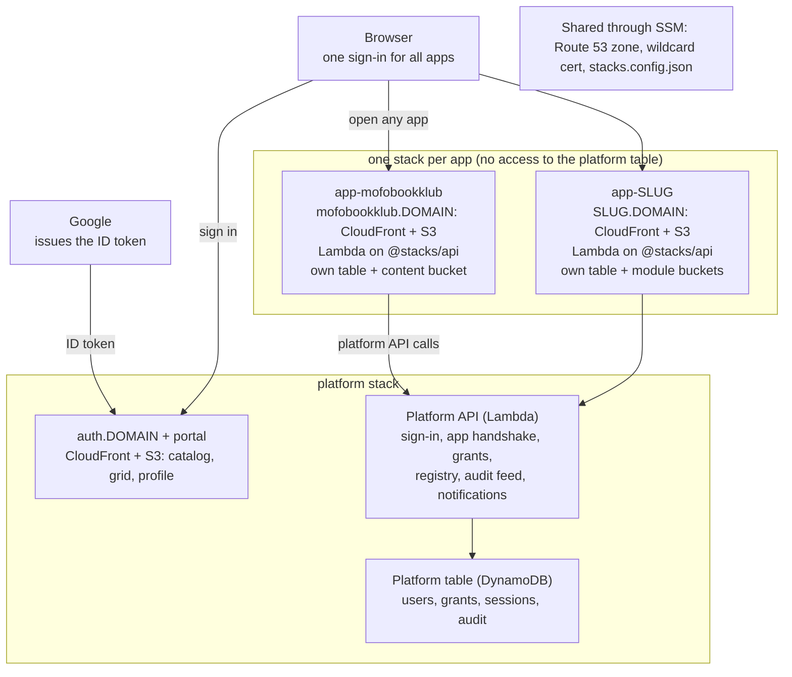
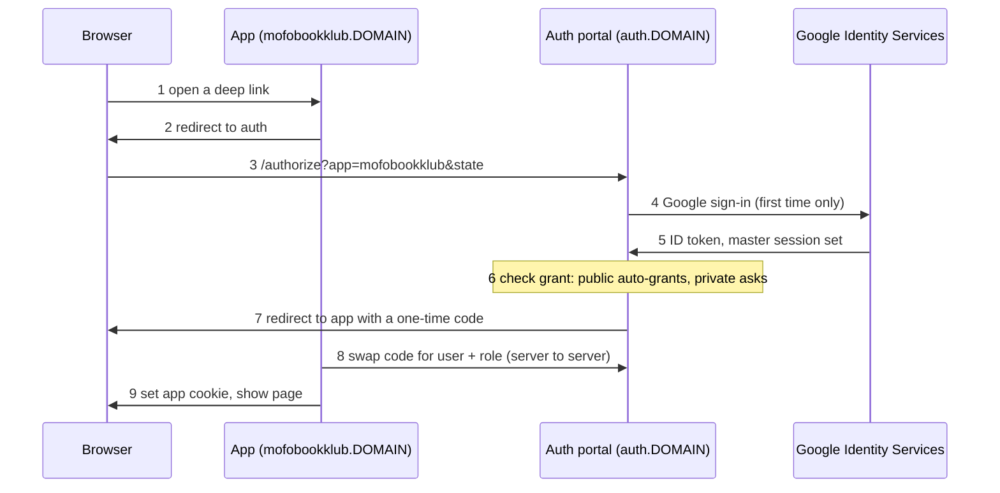

# Stacks — Platform Spec

As of 2026-11-08 · Owner: Dashiell Nash (@dashnash)

> Living source: the commented version of this spec is a Claude Doc
> (https://claude.ai/artifact/8NjxUSrNqMr9GEFRmcUsMx). This file is the copy the build agent reads.
> When they differ, update this file in the same PR as the code that depends on the change.

## Overview

Stacks is a monorepo platform on AWS for building many small, independent web apps that share one Google sign-in, one catalog and one access grid. Each app lives at its own subdomain (`<slug>.<domain>`), keeps its own data, and can look like anything its creator wants. The MOFO Book Club Portal ([dashnash/MofoBookKlubPortal](https://github.com/dashnash/MofoBookKlubPortal)) is the reference app and migrates in as app #1.

**Personas**

- **User** — browses the catalog, signs in once with Google, and deep-links straight into any app they can use.
- **App Creator** — Dash plus Claude Code users, including non-technical people. Runs `/new-app` with a short description and gets a working, tested app that inherits all shared infrastructure.
- **App Owner / Approver** — the app's top role (the creator by default). Approves requests and assigns roles for that app.
- **Platform super-admin** — sees and can override every cell of the access grid across all apps.

**Goals**

1. One Google sign-in, federated into every app, with a per-app session so a faulty app cannot leak sessions for other apps.
2. A central access grid: users as rows, apps as columns, the user's role in each cell.
3. New apps bootstrapped mostly by deterministic scripts, so Claude spends tokens only on what is unique to the app.
4. No UX restrictions: the platform ships plumbing and headless primitives, never a mandatory look.
5. Near-zero idle cost (serverless only), single AWS account, only CI deploys.

**Non-goals for v1**: runtime AI inference in apps, email alerts for access requests (badge only), per-PR preview stacks, multiple root domains at once, non-Google identity providers, cross-app data sharing.

**Success metric**: a non-technical creator goes from a one-paragraph description to an app live on staging, behind SSO, through `/new-app` in one Claude Code session, with the scaffold costing near-zero tokens.

## Decisions log

Every decision below was made in the brainstorm on 2026-11-08; the build agent treats them as fixed unless this spec changes.

| Area | Decision |
| --- | --- |
| Cloud | AWS, one account, us-east-1, CDK, serverless only |
| Identity | Google sign-in only (consumer Gmail allowed) |
| Domains | Apps on subdomains `<slug>.<domain>`; root domain is one config value (today `iamdashnash.com`), one at a time |
| Federation | Portal at `auth.<domain>` holds the master session; each app gets its own session through a silent redirect handshake |
| Stack tenancy | One `platform` stack + one CDK stack per app (option A) |
| Repo | New monorepo `dashnash/stacks` |
| Portal sign-up | Anyone can create an account, no approval |
| Public vs private apps | Every app has a public footprint. Public apps auto-grant a default role; private apps need approval |
| Roles | Each app declares its own roles in its manifest, incl. which roles can approve and the default role |
| Approvers | App approvers and the central grid both manage access; the grid is the source of truth |
| Ownership | The creator becomes the app's top role; the platform super-admin can override anything |
| Profile | Global (name, display name, avatar) |
| Audit | Both: each app keeps its own log, and every event is also copied to a central feed |
| Data | Fully isolated per app; sharing only through explicit APIs later |
| Access requests | In-app badge only (no email in v1) |
| Portal bar | Optional, light, minimizable overlay |
| Shared modules | All Tier 3 modules except runtime AI inference |
| Deploys | Only CI deploys. `CODEOWNERS` gates `packages/` and `infra/`; app folders deploy on green CI |
| Testing | In-browser demo mode for previews; one shared staging platform deployable from a Claude session via CI |
| Book Club | Migrates as app #1 with its data; current members and roles pre-loaded into the grid; members sign in once more |
| Audience | Different groups per app, up to a few dozen users at first |

## Architecture

One `platform` CDK stack holds identity, grants and the portal; each app is its own `app-<slug>` stack built from the `PlatformApp` construct (tenancy option A).



Apps reach the platform only through the Platform API, never its table, so one faulty app cannot read another app's data or sessions.

- **Stack names**: `stacks-<prod|test>-platform`, `stacks-<prod|test>-app-<slug>`, and the one-time `stacks-ci`. The `stacks-test-` prefix is what the staging guardrails scope to.
- **Platform stack**: Route 53 records for `auth.` and the portal host, the ACM wildcard certificate, the platform table, the Platform API Lambda, the portal SPA, and SSM parameters (`/stacks/<env>/...`) that app stacks read. Cross-stack values go through SSM, not CloudFormation exports, so app stacks deploy and delete independently.
- **App stack**: CloudFront + private S3 (OAC) at `<slug>.<domain>`, HTTP API at `/api/*` on the same origin, one arm64 Node 22 Lambda, one DynamoDB single table (PK, SK, GSI1, TTL), buckets only for enabled modules, its own DNS alias.
- **Limits**: 200 CloudFront distributions per account covers the few-dozen-app horizon. A new app's first deploy takes about 5 minutes for CloudFront; updates take 1–2.
- **Cost**: everything is on-demand; an idle app costs cents per month.

## Identity and federation

Only `auth.<domain>` talks to Google; every app gets its own session through a redirect handshake, so a user signs in once and never sees a second prompt.



A returning user skips steps 4 and 5, so steps 2 to 9 are redirects with no clicks.

The handshake is a minimal OAuth-style authorization-code flow that the SDK implements for every app; creators never write auth code.

- **Portal endpoints**: `GET /authorize?app&state&return&code_challenge`, `POST /token` (app server to platform, with the app's credential and the verifier), `POST /logout`, `GET /me`.
- **App endpoints from `@stacks/api`**: `GET /api/auth/callback`, `GET /api/auth/session`, `POST /api/auth/logout`. `@stacks/web` triggers the redirect when a protected call returns 401 and returns the user to the original deep link.
- **Public pages** need no session. A signed-out visitor on a private app sees its public pages and a sign-in or Request access button.
- **Grant check (step 6)**: public app with no grant → auto-grant `defaultRole`; private app with no grant → the portal's request-access page, then back to the app's public view with a pending notice.
- **Lifetimes**: master and app sessions both slide to 90 days of inactivity (Book Club's rule); the app session also stores the user's `createdAt` so deleting a user ends every session.
- **Sign-out**: from an app or the portal bar, it ends the master session and every app session for that user.

## Access model

Access is one **grant** per (user, app): a role from that app's manifest, or a pending request. The platform owns grants; apps read them and never store their own copy.

**Entities (platform table)**

| Entity | Key | Fields |
| --- | --- | --- |
| User | `USER#<email>` | `name`, `displayName`, `pictureUrl`, `createdAt`, `isPlatformAdmin` |
| App | `APP#<slug>` | manifest snapshot, `visibility` (`public`/`private`), `status` (`live`/`archived`), `createdBy` |
| Grant | `APP#<slug>` / `USER#<email>` (GSI by user) | `role` or `PENDING`, `grantedBy`, `grantedAt`, `requestedAt`, `note` |
| Master session | `SESSION#<sha256>` | `userEmail`, `expiresAt` (TTL), `lastUsedAt` |
| Audit event | `AUDIT#<yyyy-mm>` | `app`, `actor`, `action`, `label`, `details` |

App sessions are not in the platform table: each lives in its app's own table (`SESSION#<sha256>`, indexed by `USERSESSIONS#<email>`, holding the user and role). When a grant changes, the platform deletes that user's sessions in the app's table, so the next request re-runs the handshake with the new role.

**Rules**

1. Anyone with a Google account can create a portal account, no approval.
2. **Public app**: a signed-in user's first visit creates a grant with the manifest's `defaultRole`. Signed-out visitors see its public pages.
3. **Private app**: signed-out and ungranted visitors see the public pages and a **Request access** button. A request creates a `PENDING` grant and raises the approvers' badge.
4. **Approvers** are users holding a role the manifest marks `canManageAccess`. They approve, change roles or revoke, from the app's own admin page or the central grid. Both write the same grant.
5. The **creator** gets the manifest's `topRole` when the app is first registered. An app must always keep at least one holder of `topRole`.
6. The **platform super-admin** (`PLATFORM_ADMINS` config, like Book Club's `OWNER_EMAILS`) can edit any cell, archive apps, and see the full audit feed.
7. Revoking a grant ends that user's app sessions for that app immediately.

**Central access grid** (portal `/admin/access`)

- Rows = users, columns = apps, cell = role dropdown from that app's roles, plus `none` and `pending`.
- Pending cells are highlighted; a header badge counts requests the viewer can act on.
- App approvers see the grid filtered to their columns; the super-admin sees everything.
- Filters: by app, by role, pending only, search by name or email. Bulk set a role for selected rows. CSV export.
- Every change is written to the audit feed with before → after.

## App manifest

Every app is described by `apps/<slug>/app.manifest.json`, validated by a JSON Schema in `packages/manifest`. CI, the CDK construct, the catalog, the grid and the SDK's role checks all read it, so roles and visibility are declared once.

```json
{
  "slug": "mofobookklub",
  "name": "MOFO Book Klub",
  "tagline": "Nominate, vote, read, meet.",
  "description": "The club's next meeting, The Lineup and the shelf of past reads.",
  "icon": "icon.svg",
  "category": "Clubs",
  "visibility": "private",
  "roles": [
    { "id": "OWNER",  "label": "Owner",  "canManageAccess": true, "canManageApprovers": true },
    { "id": "ADMIN",  "label": "Admin",  "canManageAccess": true },
    { "id": "MEMBER", "label": "Member" }
  ],
  "topRole": "OWNER",
  "defaultRole": "MEMBER",
  "publicRoutes": ["/", "/book/*"],
  "modules": ["comments", "votes", "contentPacks", "notifications"],
  "csp": { "imgSrc": ["https:"], "connectSrc": [] },
  "portalBar": "minimized",
  "owners": ["dashiell.nash@gmail.com"]
}
```

- `slug` is the subdomain and the stack name (`app-<slug>`); lowercase, 3–30 characters, unique, immutable.
- `defaultRole` is required for public apps and is the role pre-selected on approval for private ones.
- `modules` turns on Tier 3 modules; the construct adds only the resources those modules need.
- `csp` extends the platform's default Content-Security-Policy; anything not listed stays blocked.
- `portalBar`: `shown`, `minimized` or `off`.
- Changing `roles` in a way that removes a role in use fails CI until the grants are migrated.

## Shared services

The platform ships in three tiers, almost all of it extracted from Book Club code that already runs in production (source paths in `dashnash/MofoBookKlubPortal`).

**Tier 1 — Platform services** (the `platform` stack, one instance)

| Service | Extracted from | v1 scope |
| --- | --- | --- |
| Identity and sessions | `backend/src/auth/google.ts`, `auth/session.ts` | Google ID token verification, hashed master sessions, 90-day sliding expiry, the app handshake |
| Global profile | `users/`, `shownName()`, `SettingsView` | Name, display name (30 chars), avatar; `GET /me` for apps |
| Grants and requests | Book Club's PENDING flow, `admin/users/*` | Grant CRUD, request access, approve, revoke, auto-grant for public apps |
| App registry and catalog | new | Registered from manifests on deploy; catalog page with search, categories, favorites, recently used |
| Access grid | `AdminPanel.tsx` | Described under Access model |
| Central audit feed | `audit/log.ts`, `run()` in `app.ts` | Every app event mirrored here; filter by app, actor, action |
| Notifications and badges | new | In-app notifications per user (access requests, approvals, app-defined events); badge counts |
| Portal bar | new | Web component: app switcher, avatar menu, notifications, sign out; minimizable, remembers state |

**Tier 2 — SDK packages** (shared code, each app's own data)

| Package | Contents | Extracted from |
| --- | --- | --- |
| `@stacks/api` | `Router`, `requireRole()` guards from the manifest, `run()` with auto-audit, `HttpError` helpers and validators, `Store` + `DynamoStore` + `MemoryStore`, `Deps` injection, Lambda handler, platform client (`me`, grants, notify) | `utils/router.ts`, `http.ts`, `store.ts`, `dynamo-store.ts`, `deps.ts`, `handler.ts` |
| `@stacks/web` | `StacksProvider`, `useAuth`, `useApi`, `createApi`, runtime `config.json`, `useAsync`, hash routing, formatters, headless `Modal`, `Spinner`, `ErrorNote`, `Avatar`, `RequestAccess` | `lib/auth.tsx`, `api.ts`, `config.ts`, `useAsync.ts`, `route.ts`, `format.ts`, `components/ui.tsx` |
| `@stacks/infra` | `PlatformApp` construct: S3 + OAC, CloudFront, SPA rewrite, CSP and security headers, HTTP API with throttling, arm64 Node 22 Lambda, single table with GSI1 + TTL, log retention, cache policy, `config.json` writer, module resources | `infra/lib/book-club-stack.ts` |
| `@stacks/testing` | `MemoryStore` fakes, persona sign-in, integration helpers, Playwright smoke helper | `backend/tests/helpers.ts`, `frontend/tests/fakes.tsx` |
| `@stacks/demo` | Runs the app's real API in the browser on `MemoryStore` with seeded personas; single-file demo build | `frontend/src/demo/*`, `scripts/inline-demo.mjs` |
| App template | Build-hash footer, ToS and privacy templates, Open Graph tags, favicon set, `/public/*` convention, landing page | `build-info.ts`, `public/*.html` |

**Tier 3 — Opt-in modules** (enabled per app in `manifest.modules`)

| Module | What it gives an app | Origin |
| --- | --- | --- |
| `comments` | Threaded comments on any `kind/id`, edit, soft delete, counts, moderation by approvers | `comments/routes.ts` (generalize `ThreadTarget`) |
| `votes` | Up-votes on any item, one per user, sorted lists | Lineup votes |
| `contentPacks` | JSON + images in the repo deployed to a private bucket, served by presigned URL | Easter-egg critics, `seed-easter-eggs.ts` |
| `uploads` | Presigned PUT to a private per-app bucket, size and type limits, presigned reads | new, on the presigned-read code |
| `notifications` | `notify(user, message, link)` into the platform's notification center | new (Tier 1 backend) |
| `scheduledJobs` | EventBridge schedules declared in the manifest invoke named handlers | new |
| `email` | SES sending from `no-reply@<domain>` with templates; off by default, needs SES production access | new |

Runtime AI inference is deliberately out of v1; it can be added later as a platform-proxied module with per-app budgets.

## Repo layout

One npm-workspaces monorepo, Node 22, TypeScript everywhere, Vitest for tests. An app folder is self-contained so a creator's Claude session only needs to read that folder plus `packages/*/README.md`.

```
stacks/
  CLAUDE.md                  # rules for every agent: read SDK READMEs, never edit packages/ from an app task
  .claude/skills/new-app/    # the /new-app skill (interview, scaffold, build, verify, ship)
  .github/CODEOWNERS         # @dashnash owns packages/, infra/, platform/, .github/
  .github/workflows/         # ci.yml, deploy.yml (all of staging, then production), deploy-test.yml (a branch, on demand)
  stacks.config.json         # rootDomain, hostedZoneId, googleClientId per env, PLATFORM_ADMINS
  platform/                  # the platform app itself
    api/                     # auth, handshake, grants, registry, audit feed, notifications
    web/                     # portal: catalog, profile, access grid, admin
    portal-bar/              # the overlay web component
  packages/
    api/  web/  infra/  testing/  demo/  manifest/
    modules/                 # comments, votes, content-packs, uploads, scheduled-jobs, email
  templates/app/             # what new-app copies; placeholders filled from the manifest
  apps/
    mofobookklub/
      app.manifest.json
      api/  web/  content/  tests/
      stack.ts               # new PlatformApp(this, { manifest }) and nothing else by default
  infra/
    bin/stacks.ts            # instantiates platform + one stack per apps/*/app.manifest.json
  scripts/
    new-app.ts               # deterministic scaffold
    migrate-book-club.ts     # one-time data migration
  docs/
    PLATFORM_SPEC.md         # this spec
    ARCHITECTURE.md
```

Import rule: `apps/*` may import only `@stacks/*` packages, never another app or `platform/` internals; a lint rule enforces it.

## Creator workflow

The `/new-app` skill turns a short description into a tested app on staging; scripts produce everything predictable, and Claude writes only the app's own features.

1. **Interview** (Claude, few tokens). Ask, one screen at a time, in plain language for non-technical creators: purpose, who uses it, public or private, roles and who approves, the 3–5 things it tracks, what signed-out visitors see, the look and feel (3 adjectives or a reference site), which modules it needs. Write `app.manifest.json` plus `apps/<slug>/BRIEF.md` (the description, entities, user stories). Show both back for a yes.
2. **Scaffold** (script, zero tokens). `npm run new-app -- <slug>` copies `templates/app/`, fills placeholders from the manifest, adds the stack, wires auth, roles, audit, demo personas (one per role), tests, landing page and footer. It must pass typecheck and tests before Claude writes a line.
3. **Build** (Claude). Reads only `BRIEF.md`, `packages/*/README.md` (each under ~300 lines, API cheat-sheet style) and, when useful, the matching folder in `apps/mofobookklub` as a worked example. Writes entities, routes, UI and tests. The UI is unconstrained: any layout, styling or component library the CSP allows.
4. **Verify** (script + Claude). Typecheck, unit and integration tests, demo build, a Playwright pass that signs in as every persona and screenshots the main pages. Claude reviews the screenshots with the creator and iterates.
5. **Stage** (CI). `gh workflow run deploy-test.yml -f app=<slug> -f ref=<branch>`; the session waits on the run and returns `https://<slug>.test.<domain>`.
6. **Ship** (PR). Claude opens a PR; CI runs; merge deploys `app-<slug>` to production and registers it in the catalog with the creator as `topRole`.

**Token discipline**

- The skill never asks Claude to write infrastructure, auth, audit or CI code; if a feature needs it, it is a platform change in `packages/` reviewed by `CODEOWNERS`.
- Per-step token use is logged to `apps/<slug>/.stacks/usage.json` for tuning.
- Eval set: build 4 reference apps through the skill (potluck sign-up, shared wishlist, pickup-game scheduler, a book club clone) and record tokens and wall time per step. Anything Claude writes the same way twice moves into the template or an SDK helper.
- Target to tune against: scaffold to green tests with 0 Claude tokens; whole run inside one session's context without compaction.

**Guardrails for non-technical creators**

- No AWS credentials in sessions; only CI deploys.
- `CLAUDE.md` forbids edits outside `apps/<slug>/` during an app task; CI fails a PR from an app branch that touches `packages/`, `platform/`, `infra/` or another app.
- The manifest schema caps CSP additions and module choices; anything else needs a platform PR.

## Environments and CI/CD

There are three environments, and only GitHub Actions ever holds AWS credentials.

| Environment | Where | Deployed by | Data |
| --- | --- | --- | --- |
| Demo | In the browser, `npm run demo -w apps/<slug>` | Nobody (local) | `MemoryStore`, seeded personas |
| Staging | `*.test.<domain>`, a full second platform | `deploy.yml` on push to `main` (platform and every app), and `deploy-test.yml` (`workflow_dispatch`: app + branch), callable from a Claude session with `gh` | Separate tables; last deploy of an app wins (a merge to `main` puts it back to `main`) |
| Production | `*.<domain>` | `deploy.yml` on push to `main` | Real |

**Pipelines**

- `ci.yml` on every PR: install, lint (incl. the import rule and the path guard for app branches), typecheck, tests for changed workspaces, manifest validation, `cdk synth` of changed stacks.
- `deploy.yml` on `main`: staging first (platform, then every app, max 4 at a time), so a broken change stops before production; then the production platform, then every production app. CloudFormation skips unchanged stacks. Apps in an environment's `holdApps` are left out of it.
- `deploy-test.yml`: one app from a branch to staging, before merging; posts the URL as the run summary.
- Auth to AWS uses GitHub OIDC with an IAM role per environment (no long-lived keys, unlike Book Club today). Both roles trust only their GitHub environment (`staging`, `production`), and both environments allow only `main`.

**Staging deploys without AWS credentials**

Developers and Claude sessions never hold AWS credentials; anyone with push access starts a staging deploy with `gh workflow run deploy-test.yml -f app=<slug> -f ref=<branch>`, and GitHub OIDC gives the workflow 1-hour credentials. Because a dispatched workflow normally runs the branch's own copy of the workflow file, and app code runs during install and synth, the pipeline is built so no branch code ever runs next to credentials:

| Control | Rule |
| --- | --- |
| Workflow from `main` | `deploy-test.yml` is always dispatched on `main`; the branch is only an input. The staging IAM role trusts only `repo:dashnash/stacks:environment:staging`, and the `staging` GitHub environment allows only `main`. |
| Build and deploy split | Job 1 checks out the branch, installs, tests and synthesizes the cloud assembly with no AWS credentials (no CDK context lookups; config comes from `stacks.config.json`). Job 2 alone gets credentials and runs no app code: only `cdk deploy --app <assembly>`. |
| Assembly check | Job 2 refuses an assembly containing any stack other than `stacks-test-app-<slug>`, or IAM resources outside the allowed name patterns. |
| Permissions boundary | Staging is bootstrapped with its own qualifier (`stktest`) and the execution policy `stacks-test-cfn-exec` instead of admin; every role a staging deploy creates must carry the `stacks-test-boundary` permissions boundary; both deny anything on resources tagged `stacks:env=production`, and no IAM users or keys can be created. |
| Production | The prod role trusts only the `production` environment, which allows only `main`. |

One AWS account is kept on purpose; these controls are the isolation. If a Claude session cannot dispatch workflows through its GitHub proxy, the creator runs the same `gh workflow run` command, or the GitHub Actions page's "Run workflow" button, themselves; a push-triggered fallback would run the branch's own workflow file and is not allowed. One-time AWS and GitHub setup: `docs/SETUP.md`.

**Config (`stacks.config.json`)**: per environment `rootDomain`, `hostedZoneId`, `googleClientId`, `platformAdmins`. Changing `rootDomain` and redeploying moves everything; sessions are per-domain so users sign in again.

**Certificates**: one ACM wildcard cert per environment (`*.<domain>` and `*.test.<domain>`) in us-east-1, owned by the platform stack and shared via SSM.

**Google OAuth**: one client per environment, with exactly one authorized JavaScript origin each (`https://auth.<domain>`, `https://auth.test.<domain>`); apps never talk to Google.

**Later**: per-PR preview stacks (`app-<slug>-pr<N>`) created on a label and destroyed on close.

## Book Club migration

Book Club moves into `apps/mofobookklub` as a private app; its data is kept, members and roles land in the grid, and everyone signs in once more.

1. Copy the app code (books, meetings, lineup, comments, easter eggs, views) from `dashnash/MofoBookKlubPortal`; replace its `auth/`, `users/`, `audit/` and `utils/` with `@stacks/*` imports; comments and votes move onto the shared modules; easter eggs become a `contentPacks` pack.
2. Its admin page keeps member controls but they now read and write platform grants; the activity log reads the app's own audit partition.
3. `tools/migrate-book-club` (run by Dash with admin credentials, `--dry-run` first): copy every non-user, non-session item from `BookClubTable` into the new app table unchanged; create platform users and grants from `USER#` items (`OWNER`, `ADMIN`, `MEMBER` keep their role; `PENDING` becomes a pending request); copy audit history; drop sessions.
4. Display names move to the global profile; the first sign-in to the portal keeps an existing Book Club display name.
5. Deploy to staging, check with a copy of production data, then production. Keep the old stack read-only for 30 days, then destroy it.
6. The new app takes over Book Club's existing address, `mofobookklub.<domain>`: the old stack releases the hostname first (`holdApps` keeps production off it until then). Runbook: `docs/BOOK_CLUB_MIGRATION.md`.

Done when every existing member can sign in at the new URL and sees their history, nominations, votes and comments.

## Security

The design assumes any single app may be buggy or malicious and limits what it can reach.

- **Sessions**: master session cookie `__Host-stacks` on `auth.<domain>` only. App sessions are opaque 256-bit tokens in an HttpOnly, Secure, `SameSite=Lax`, host-only cookie on the app's own subdomain. Only SHA-256 hashes are stored. No tokens in `localStorage` (a change from Book Club).
- **Handshake**: `state` and PKCE-style verifier, single-use authorization codes valid 60 seconds, `redirect_uri` must equal a registered app's origin, codes bound to the app slug.
- **IAM**: each app Lambda can read and write only its own table and buckets; it reaches the platform only through the platform API with a per-app credential, never the platform table directly. Audit writes are restricted to that app's partition. CI deploy roles follow the staging rules under Environments and CI/CD, including a permissions boundary on the staging role.
- **CSRF**: state-changing app routes need the cookie plus a custom header (`X-Stacks-Request: 1`) added by `@stacks/web`; CORS stays off because API and SPA share an origin.
- **Headers**: CSP per app (default from Book Club's policy plus manifest additions), HSTS, `nosniff`, `frame-ancestors 'none'`, strict referrer policy.
- **Throttling**: API Gateway rate limits per app; the platform API has its own, tighter limits on login and request-access.
- **Revocation**: removing a grant or a user deletes their app sessions at once; super-admin can force sign-out everywhere.
- **Supply chain**: `CODEOWNERS` review on shared code, lockfile committed, Dependabot on, no install scripts from new dependencies without review.
- **Privacy**: apps see only email, display name and avatar of users with a grant; full Google names are never sent, as in Book Club.

## Build plan

Five phases; each ends with a gate the build agent must demonstrate before starting the next. Milestone 1 = phases 1–4.

**Phase 1 — Foundations** (done)

- [x] Monorepo skeleton, workspaces, lint, typecheck, Vitest, `CLAUDE.md`, `CODEOWNERS`
- [x] `@stacks/api`, `@stacks/web`, `@stacks/testing`, `@stacks/demo` extracted from Book Club with their tests
- [x] `@stacks/manifest` schema and validator
- [x] `@stacks/infra` `PlatformApp` construct with `cdk synth` snapshot tests
- [x] GitHub OIDC roles and the three workflows

Gate: a hello-world app synthesizes, its tests pass, and its demo build runs in a browser.

**Phase 2 — Platform** (built; staging gate pending first deploy)

- [x] `platform` stack: cert, DNS, platform table, platform API, portal web
- [x] Google sign-in at `auth.<domain>`, master session, app handshake, `GET /me`
- [x] Registry, catalog, public app pages, request access, grants, auto-grant for public apps
- [x] Access grid, notifications and badges, central audit feed
- [x] Portal bar web component

Gate on staging: sign in once, open two apps on different subdomains with no second prompt; request access to a private app, approve it from the grid, and the user gets in; revoking ends their app session within one request.

Phase 2 build notes:
- The same gate runs in memory in `platform/api/tests/e2e.test.ts` (two real apps, the real platform, a browser with per-host cookies). It needs repeating on staging once `docs/SETUP.md` is done.
- **Registry**: each app stack writes `/stacks/<env>/apps/<slug>/manifest` and `/table` to SSM. The platform reads these (cached a minute) and registers an app the first time it sees it, giving the manifest's `owners` the top role.
- **Portal bar**: a React component in `@stacks/web`, rendered by `<StacksProvider>`. It gets its data from the app's own `/api/stacks/bar`, which asks the platform server-to-server, so the portal cookie never leaves `auth.<domain>` and no CORS is needed.
- **Sign-out** from any app or the portal ends the master session and the user's sessions in every app.

**Phase 3 — Book Club migration** (built; cut-over run by Dash, `docs/BOOK_CLUB_MIGRATION.md`)

- [x] `apps/mofobookklub` on the SDK and shared modules
- [x] Migration script (`tools/migrate-book-club`); dry run on a copy of production data is the first cut-over step
- [ ] Production cut-over and redirect

Gate: every existing member's data visible after sign-in; grid shows their roles.

Phase 3 build notes:
- **Votes stay in Book Club** for now: its votes are tied to The Lineup's key layout. A generic `votes` module is extracted in phase 4 with the other remaining modules.
- **App admin pages manage access through the platform**: `GET /stacks/access` and `PUT /stacks/access/:email` in every app (approvers only) call the Platform API (`/api/apps/:slug/access`), which applies the grid's rules with the app vouching for the acting user.
- **Members and names** come from the platform (`appMembers`, `getPeople` in `@stacks/api`, cached 30 s), so apps keep no user records. People who lose access show as "Former member".
- **Photos of people never go in git.** Book Club's shared faces live only in its content bucket; the migration copies them bucket to bucket. Content deploys never prune.
- **Notifications from apps**: `deps.platform.notify(email, text, link)`, members only.
- The **portal bar** moved to the bottom-right: apps usually keep their own account menu top-right.
- **Book Club keeps its address**: its slug is `mofobookklub`, so it lives at `mofobookklub.<domain>` like any app. While the old stack still owns that hostname, `holdApps` in `stacks.config.json` keeps it out of production (staging is unaffected).
- Book Club's `GOOGLE_BOOKS_API_KEY` is not wired yet; book sources work without it at a lower Google Books quota.

**Phase 4 — `/new-app`**

- [ ] `templates/app/` and `scripts/new-app.ts`
- [ ] The skill: interview, scaffold, build, verify, stage, ship
- [ ] Remaining modules: uploads, scheduled jobs, email
- [ ] Eval run on the 4 reference apps, usage logged

Gate: a non-technical user builds one app end to end in a single Claude Code session and it is live on staging.

**Phase 5 — Hardening (after milestone 1)**

- [ ] Per-PR preview stacks
- [ ] Cost and usage dashboard per app
- [ ] Template and SDK tuning from eval results

## Open questions

These are defaulted as written above; change any by editing this spec or commenting on the Claude Doc.

- [x] Portal address: decided in phase 2. The portal (catalog and sign-in) lives at `auth.<domain>`; the bare `<domain>` redirects there. One host keeps the master session cookie in one place.
- [ ] Does Book Club keep a vanity host (e.g. `books.<domain>`) or use its slug `mofobookklub.<domain>`?
- [ ] Session lifetime: keep Book Club's 90-day sliding expiry for both master and app sessions?
- [ ] Should private apps be listed in the catalog to everyone, or only the name and tagline with Request access? Default: listed with Request access.
- [ ] SES: request production access now so `email` works on day one, or defer until an app needs it?
- [ ] Who besides Dash is in `PLATFORM_ADMINS`?
- [ ] Should public apps have a "blocked" state? Removing someone from a public app today only lasts until they sign in again (they get the default role back).
