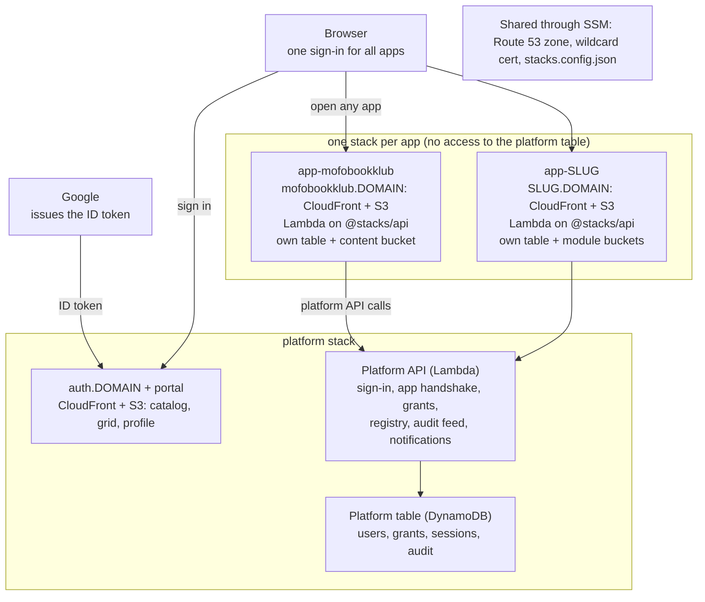
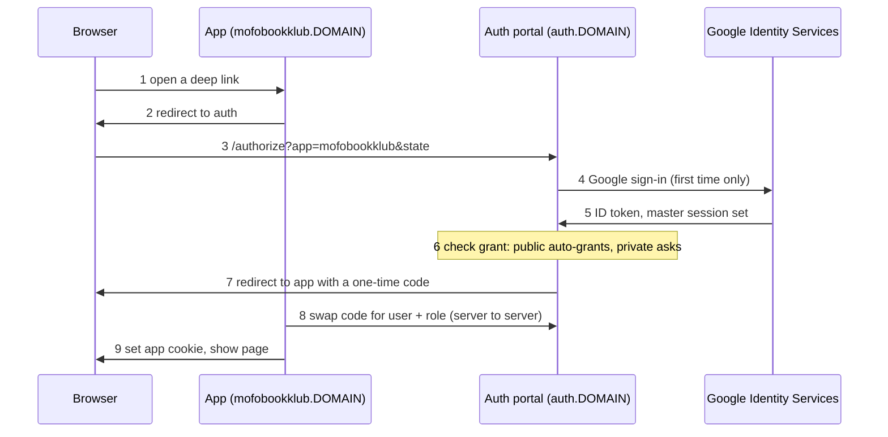

# Stacks — Platform Spec

As of 2026-11-08 · Owner: Dashiell Nash (@dashnash)

> Living source: the commented version of this spec is a Claude Doc
> (https://claude.ai/artifact/8NjxUSrNqMr9GEFRmcUsMx). This file is the copy the build agent reads.
> When they differ, update this file in the same PR as the code that depends on the change.

## Overview

Stacks is a monorepo platform on AWS for building many small, independent web apps that share one Google sign-in, one catalog and one access grid. Each app lives at its own subdomain (`<slug>.<domain>`), keeps its own data, and can look like anything its creator wants. The MOFO Book Club Portal ([dashnash/MofoBookKlubPortal](https://github.com/dashnash/MofoBookKlubPortal)) is the reference app and migrates in as app #1.

**Personas**

- **User** — browses the catalog, signs in once with Google, and deep-links straight into any app they can use.
- **App Creator** — Dash plus Claude Code users, including non-technical people. Runs `/new-app` with a short description and gets a working, tested app that inherits all shared infrastructure.
- **App Owner / Approver** — the app's top role (the creator by default). Approves requests and assigns roles for that app.
- **Platform super-admin** — sees and can override every cell of the access grid across all apps.

**Goals**

1. One Google sign-in, federated into every app, with a per-app session so a faulty app cannot leak sessions for other apps.
2. A central access grid: users as rows, apps as columns, the user's role in each cell.
3. New apps bootstrapped mostly by deterministic scripts, so Claude spends tokens only on what is unique to the app.
4. No UX restrictions: the platform ships plumbing and headless primitives, never a mandatory look.
5. Near-zero idle cost (serverless only), single AWS account, only CI deploys.

**Non-goals for v1**: runtime AI inference in apps, email alerts for access requests (badge only), per-PR preview stacks, multiple root domains at once, non-Google identity providers, cross-app data sharing.

> **Planned change (draft):** `docs/NATIVE_APP_SPEC.md` adds a native iOS/iPadOS app, Sign in with Apple (lifting the "non-Google identity providers" non-goal), internal user IDs in place of email keys, and APNs push. N1a (internal user ids) is built; the rest isn't. This spec stays authoritative until each phase lands.

**Success metric**: a non-technical creator goes from a one-paragraph description to an app live on staging, behind SSO, through `/new-app` in one Claude Code session, with the scaffold costing near-zero tokens.

## Decisions log

Every decision below was made in the brainstorm on 2026-11-08; the build agent treats them as fixed unless this spec changes.

| Area | Decision |
| --- | --- |
| Cloud | AWS, one account, us-east-1, CDK, serverless only |
| Identity | Google sign-in only (consumer Gmail allowed) |
| Domains | Apps on subdomains `<slug>.<domain>`; root domain is one config value (`dashnash.ninja`, staging `test.dashnash.ninja`; moved from `iamdashnash.com` in #42), one at a time. An old root is kept only as 301 redirects (`legacyRedirects`); `iamdashnash.com` keeps only `mofobookklub.` (#140), the rest is free for the homelab |
| Federation | Portal at `auth.<domain>` holds the master session; each app gets its own session through a silent redirect handshake |
| Stack tenancy | One `platform` stack + one CDK stack per app (option A) |
| Repo | New monorepo `dashnash/stacks` |
| Portal sign-up | Anyone can create an account, no approval |
| Public vs private apps | Every app has a public footprint. Public apps auto-grant a default role; private apps need approval |
| Roles | Each app declares its own roles in its manifest, incl. which roles can approve and the default role |
| Approvers | App approvers and the central grid both manage access; the grid is the source of truth |
| Ownership | The creator becomes the app's top role; the platform super-admin can override anything |
| Profile | Global (name, display name, avatar) |
| Audit | Both: each app keeps its own log, and every event is also copied to a central feed |
| Data | Fully isolated per app; sharing only through explicit APIs later |
| Access requests | In-app badge only (no email in v1) |
| Account menu | The same control at the top right of the portal and every app: sign in, your apps, inbox, settings, manage access, app-specific items, sign out (of everything). Required in every app, enforced by a test |
| Shared modules | All Tier 3 modules except runtime AI inference |
| Deploys | Only CI deploys. The repo is public and a ruleset on `main` (`.github/rulesets/main.json`) enforces PRs, green CI, one approval on every PR and `CODEOWNERS` review of shared code. Agent sessions merge approved PRs in plan order (the merge train) |
| Testing | In-browser demo mode for previews; one shared staging platform deployable from a Claude session via CI |
| Deploy scope (#47, 2026-11-22) | A merge deploys what it changed since the last green Deploy run: nothing for docs only, one app's stacks for one app, else everything. Deploy still runs for every merge (the merge train waits for it); `ci.yml` runs on PRs only |
| Book Club | Migrates as app #1 with its data; current members and roles pre-loaded into the grid; members sign in once more |
| Audience | Different groups per app, up to a few dozen users at first |
| Monitoring (#75, 2026-11-14) | Troubleshooting first, pull only: structured JSON logs with a request ref, browser errors captured by `@stacks/web`, one CloudWatch dashboard per environment and saved Logs Insights queries. AWS-native only; no alerts, no vendor, no tracing ("Monitoring") |
| Monitoring page (#81, 2026-11-21) | Reverses #75's "no portal page": the portal has `/admin/monitoring` for platform admins only, a native page (the Platform API reads `GetMetricData` and Logs Insights; no iframe, no CSP change, no chart library). Each portal shows its own environment; the client names one of the saved queries plus a validated ref, user id or app, never query text. Names are filled in at read time, logs stay id-only. The CloudWatch dashboards and saved queries stay as the fallback ("Monitoring", `docs/specs/81-admin-monitoring.md`) |
| Realtime (#51, 2026-11-11) | `realtime` module: one AppSync Event API per app that turns it on (managed fan-out, no idle cost, ~$1 per million events). Server and client publish, channels declared with guards, short-lived HMAC tokens checked by a Lambda authorizer. Game input goes over WebRTC data channels (#44); realtime only carries their setup |
| Game servers (#44, 2026-11-14) | `gameServer` module: server-authoritative rooms, one on-demand arm64 Fargate task per room on a shared VPC with public subnets (no NAT, no load balancer, no warm pool), players connected over WebRTC data channels to the task's public IP; the `realtime` module only signals. Peer hosting (players connected to each other, one of them the host) was considered and rejected: no authority, host migration, and worse NAT traversal. Rooms run a pinned public Node image; the app's game is one bundled file (a CDK file asset, like Lambda code) the task fetches from S3 through a link the API signs, so no per-app image is built, shipped or stored. (First shipped as a per-app image tarball; dropped on 2026-11-15 because every deploy downloaded ~200 MB of images on the runners.) |
| Seats per device (#131, 2026-11-20) | A room seat is keyed by (user, device), not by user: `PLAYER#<seatId>`, seat id = the user id for the `default` device (so games and SDKs from before are unchanged), else `<userId>~<device>`. The ticket carries the device; takeover is per seat. A special "display" role was considered and rejected: the game decides what each seat does. Answers still go to the user's channel (the channel guard is per user); the client's `sid` tells their connections apart. One person holds at most 4 seats (API-enforced, so labels can't fill a room); a game's `maxSeatsPerUser` lowers it. A room keeps the runtime it started with, so a room started before the deploy that brings devices treats one person's devices as one seat until it ends. |

## Architecture

One `platform` CDK stack holds identity, grants and the portal; each app is its own `app-<slug>` stack built from the `PlatformApp` construct (tenancy option A).



Apps reach the platform only through the Platform API, never its table, so one faulty app cannot read another app's data or sessions.

- **Stack names**: `stacks-<prod|test>-platform`, `stacks-<prod|test>-app-<slug>`, `stacks-<prod|test>-legacy-redirect` (only with `legacyRedirects`), and the one-time `stacks-ci`. The `stacks-test-` prefix is what the staging guardrails scope to.
- **Platform stack**: Route 53 records for `auth.` and the portal host, the ACM wildcard certificate, the platform table, the Platform API Lambda, the portal SPA, and SSM parameters (`/stacks/<env>/...`) that app stacks read. Cross-stack values go through SSM, not CloudFormation exports, so app stacks deploy and delete independently.
- **App stack**: CloudFront + private S3 (OAC) at `<slug>.<domain>`, HTTP API at `/api/*` on the same origin, one arm64 Node 22 Lambda, one DynamoDB single table (PK, SK, GSI1, TTL), buckets only for enabled modules, its own DNS alias.
- **Legacy-redirect stack**: per old root in `legacyRedirects`, one CloudFront distribution holding `<old>` and `*.<old>`, or with `hosts` only `<label>.<old>` for each listed label (own ACM certificate and alias records in the old zone) whose viewer-request function 301s every request to the same host label + path + query on the new root (bare old root → `auth.`; anything else, e.g. a lookalike host, → the portal's front page). It serves nothing else: no content, API or apple-app-site-association. It depends on the platform and every app stack, so `cdk deploy --all` deploys it last, after they have dropped the old names (a CloudFront alias can only be on one distribution).
- **Limits**: 200 CloudFront distributions per account covers the few-dozen-app horizon. A new app's first deploy takes about 5 minutes for CloudFront; updates take 1–2.
- **Cost**: everything is on-demand; an idle app costs cents per month.

## Identity and federation

Only `auth.<domain>` talks to Google; every app gets its own session through a redirect handshake, so a user signs in once and never sees a second prompt.



A returning user skips steps 4 and 5, so steps 2 to 9 are redirects with no clicks.

The handshake is a minimal OAuth-style authorization-code flow that the SDK implements for every app; creators never write auth code.

- **Portal endpoints**: `GET /authorize?app&state&return&code_challenge`, `POST /token` (app server to platform, with the app's credential and the verifier), `POST /logout`, `GET /me`.
- **App endpoints from `@stacks/api`**: `GET /api/auth/callback`, `GET /api/auth/session`, `POST /api/auth/logout`. `@stacks/web` triggers the redirect when a protected call returns 401 and returns the user to the original deep link.
- **Public pages** need no session. A signed-out visitor on a private app sees its public pages and a sign-in or Request access button.
- **Grant check (step 6)**: public app with no grant → auto-grant `defaultRole`; private app with no grant → the portal's request-access page, then back to the app's public view with a pending notice.
- **Lifetimes**: master and app sessions both slide to 90 days of inactivity (Book Club's rule); the app session also stores the user's `createdAt` so deleting a user ends every session.
- **Silent sign-in**: signed in to the platform means signed in to every app. When an app page loads without an app session, `@stacks/web` asks the platform in the background (`GET /api/silent-authorize`, a credentialed `fetch` that only the app's own origin may read, CORS), with the same PKCE state as the redirect flow; a code comes back, the page hands it to the app's `/api/auth/silent-finish`, and the app session starts with no click or redirect. It re-asks when the person returns to the tab (at most every 30 s). It never files a request: for a private app without a role it answers `access_required`, and the account control offers **Request access**, which goes through `/authorize` (and files the request) only when clicked. Public apps grant their default role as before.
- **Signing in to an app signs in to the platform** (the redirect flow goes through the portal's Google sign-in).
- **Sign-out**: there is one "Sign out", in the account menu of the portal and every app. It ends the master session and every app session for that user (an app-only sign-out would silently sign people back in). From an app it returns to the page you were on (`/logout?return=<url>`, accepted only for the platform's own apps), now signed out; from the portal it stays on the portal.

## Access model

Access is one **grant** per (user, app): a role from that app's manifest, or a pending request. The platform owns grants; apps read them and never store their own copy.

**Entities (platform table)**

| Entity | Key | Fields |
| --- | --- | --- |
| User | `USER#<id>` (`u_…`; `EMAIL#<email>` and `IDENTITY#google#<sub>` point to it; identities list by GSI `USERIDENTITIES#<id>`) | `email`, `name`, `displayName`, `pictureUrl`, `createdAt`, `primaryIdentity`, `emails` (linked), `mergedFrom`; a merged-away account keeps only `mergedInto` (an alias). Admins come from `platformAdmins`, by email |
| App | `APP#<slug>` | manifest snapshot, `visibility` (`public`/`private`), `status` (`live`/`archived`), `createdBy` |
| Grant | `APP#<slug>` / `GRANT#<userId>` (GSI by user) | `role`, `PENDING` or `BLOCKED`, `grantedBy`, `grantedAt`, `requestedAt`, `note` |
| Master session | `SESSION#<sha256>` | `userId`, `expiresAt` (TTL), `lastUsedAt` |
| Audit event | `AUDIT#<yyyy-mm>` | `app`, `actorId`, `actorName`, `action`, `label`, `details` |

App sessions are not in the platform table: each lives in its app's own table (`SESSION#<sha256>`, indexed by `USERSESSIONS#<userId>`, holding the user and role). When a grant changes, the platform deletes that user's sessions in the app's table, so the next request re-runs the handshake with the new role.

**Rules**

1. Anyone with a Google account can create a portal account, no approval.
2. **Public app**: a signed-in user's first visit creates a grant with the manifest's `defaultRole`. Signed-out visitors see its public pages.
3. **Private app**: signed-out and ungranted visitors see the public pages and a **Request access** button. A request creates a `PENDING` grant and raises the approvers' badge.
4. **Approvers** are users holding a role the manifest marks `canManageAccess`. They approve, change roles or revoke, from the app's own admin page or the central grid. Both write the same grant.
5. The **creator** gets the manifest's `topRole` when the app is first registered. An app must always keep at least one holder of `topRole`.
6. The **platform super-admin** (`PLATFORM_ADMINS` config, like Book Club's `OWNER_EMAILS`) can edit any cell, archive apps, see the full audit feed, and open the Monitoring page (`/admin/monitoring`, #81).
7. Revoking a grant ends that user's app sessions for that app immediately.
8. **Blocking**: approvers (and the super-admin) can set a cell to `BLOCKED`, from the grid or the
   app's own access page. A blocked person has no role and keeps none of their sessions; a public app
   stops auto-granting them and a private app stops taking their requests (no approver
   notifications). Sign-in answers `access_denied`, and the account menu shows **No access · switch
   account**. Blocking follows the role rules: only approver-managers can block an approver, the last
   `topRole` holder can't be blocked, and platform admins can't be blocked at all. Unblocking sets the
   cell back to no grant (or straight to a role). Audit actions: `grant.block`, `grant.unblock`.

**Central access grid** (portal `/admin/access`)

- Rows = users, columns = apps, cell = role dropdown from that app's roles, plus `none` and `pending`.
- Pending cells are highlighted; a header badge counts requests the viewer can act on.
- App approvers see the grid filtered to their columns; the super-admin sees everything.
- Filters: by app, by role, pending only, search by name or email. Bulk set a role for selected rows. CSV export.
- Every change is written to the audit feed with before → after.

## App manifest

Every app is described by `apps/<slug>/app.manifest.json`, validated by a JSON Schema in `packages/manifest`. CI, the CDK construct, the catalog, the grid and the SDK's role checks all read it, so roles and visibility are declared once.

```json
{
  "slug": "mofobookklub",
  "name": "MOFO Book Klub",
  "tagline": "Nominate, vote, read, meet.",
  "description": "The club's next meeting, The Lineup and the shelf of past reads.",
  "icon": "icon.svg",
  "category": "Clubs",
  "visibility": "private",
  "roles": [
    { "id": "OWNER",  "label": "Owner",  "canManageAccess": true, "canManageApprovers": true },
    { "id": "ADMIN",  "label": "Admin",  "canManageAccess": true },
    { "id": "MEMBER", "label": "Member" }
  ],
  "topRole": "OWNER",
  "defaultRole": "MEMBER",
  "publicRoutes": ["/", "/book/*"],
  "modules": ["comments", "votes", "contentPacks", "notifications"],
  "csp": { "imgSrc": ["https:"], "connectSrc": [] },
  "accountMenu": "standard",
  "secrets": [{ "name": "GOOGLE_BOOKS_API_KEY", "description": "Books API key", "optional": true }],
  "owners": ["dashiell.nash@gmail.com"]
}
```

- `slug` is the subdomain and the stack name (`app-<slug>`); lowercase, 3–30 characters, unique, immutable.
- `defaultRole` is required for public apps and is the role pre-selected on approval for private ones.
- `modules` turns on Tier 3 modules; the construct adds only the resources those modules need.
- `csp` extends the platform's default Content-Security-Policy; anything not listed stays blocked.
- `accountMenu`: `standard` (the app renders `<AccountMenu />`) or `custom` (it draws its own from `useAccountMenu()`). The old `portalBar` field is accepted and ignored.
- `needsEmail` (default off) gives the app people's email addresses on `v.user`, members and its access page. Turning it on is platform work: CI marks the PR for code-owner review and refuses it on an `app/<slug>/` branch. No app uses it today.
- `native` (optional) lists what the app asks of the iOS app: `camera`, `haptics`, `motion`, `screen` (`docs/NATIVE_APP_SPEC.md`, "Native capabilities"). The shell refuses undeclared calls. Adding a sensitive one (`camera`, `motion`; later `microphone`, `location`) is platform work, like `needsEmail`.
- `secrets` names the keys the app's server needs (at most 10, upper case). Values never go in git, CI or
  Lambda environment variables: an admin stores each as an SSM SecureString at
  `/stacks/<prod|test>/secrets/<slug>/<NAME>` from their own machine. That path is outside
  `/stacks/<env>/apps/`, so the platform's registry never reads it. The app stack lets the app's Lambda
  read only its own prefix (and decrypt only through SSM); the app reads values with `deps.secret(name)`
  (cached 5 minutes, so a new value applies within minutes, no deploy). Required secrets that aren't set
  are listed by name in `/api/health` as `missingSecrets`. `/new-app` adds the declaration and tells the
  creator which command to run.
- Changing `roles` in a way that removes a role in use fails CI until the grants are migrated.

## Shared services

The platform ships in three tiers, almost all of it extracted from Book Club code that already runs in production (source paths in `dashnash/MofoBookKlubPortal`).

**Tier 1 — Platform services** (the `platform` stack, one instance)

| Service | Extracted from | v1 scope |
| --- | --- | --- |
| Identity and sessions | `backend/src/auth/google.ts`, `auth/session.ts` | Google ID token verification, hashed master sessions, 90-day sliding expiry, the app handshake |
| Global profile | `users/`, `shownName()`, `SettingsView` | Name, display name (30 chars), avatar; `GET /me` for apps |
| Grants and requests | Book Club's PENDING flow, `admin/users/*` | Grant CRUD, request access, approve, revoke, auto-grant for public apps |
| App registry and catalog | new | Registered from manifests on deploy; catalog page with search, categories, favorites, recently used. Each card shows the app's preview (`https://<slug>.<domain>/preview.png`, written from the demo by `verify-app` into `web/public/`, demo data only; the initial on a tile when missing). Clicking a card opens the app (signed-out and no-access visitors get its landing page, which offers sign-in or Request access); **Details** opens the app's portal page |
| Access grid | `AdminPanel.tsx` | Described under Access model |
| Central audit feed | `audit/log.ts`, `run()` in `app.ts` | Every app event mirrored here; filter by app, actor, action |
| Notifications and badges | new | In-app notifications per user (access requests, approvals, app-defined events); badge counts |
| Account menu | new | `<AccountMenu>` in `@stacks/web` for apps, `AccountMenuView` for the portal; data from the app's `/api/stacks/account` (server-to-server to the platform) |

**Tier 2 — SDK packages** (shared code, each app's own data)

| Package | Contents | Extracted from |
| --- | --- | --- |
| `@stacks/api` | `Router`, `requireRole()` guards from the manifest, `run()` with auto-audit, `HttpError` helpers and validators, `Store` + `DynamoStore` + `MemoryStore`, `Deps` injection, Lambda handler, platform client (`me`, grants, notify), structured `log` with request context and error refs, `/stacks/client-error` | `utils/router.ts`, `http.ts`, `store.ts`, `dynamo-store.ts`, `deps.ts`, `handler.ts` |
| `@stacks/web` | `StacksProvider`, `useAuth`, `useApi`, `createApi`, runtime `config.json`, `useAsync`, hash routing, formatters, headless `Modal`, `Spinner`, `ErrorNote` (shows the error ref), `Avatar`, `RequestAccess`, browser error reporting and `ErrorBoundary`, sharing (`useShare` for an app's own links, `useShareTarget` for what the iOS app's Share button sends, #61), `@stacks/web/vite`'s `stacksLinkPreview()` (link-preview tags from the manifest) | `lib/auth.tsx`, `api.ts`, `config.ts`, `useAsync.ts`, `route.ts`, `format.ts`, `components/ui.tsx` |
| `@stacks/infra` | `PlatformApp` construct: S3 + OAC, CloudFront, SPA rewrite, CSP and security headers, HTTP API with throttling, arm64 Node 22 Lambda, single table with GSI1 + TTL, log retention, cache policy, `config.json` writer, module resources, named JSON log groups with metric filters, the environment dashboard and saved queries (`Monitoring`) | `infra/lib/book-club-stack.ts` |
| `@stacks/testing` | `MemoryStore` fakes, persona sign-in, integration helpers, Playwright smoke helper | `backend/tests/helpers.ts`, `frontend/tests/fakes.tsx` |
| `@stacks/demo` | Runs the app's real API in the browser on `MemoryStore` with seeded personas; single-file demo build | `frontend/src/demo/*`, `scripts/inline-demo.mjs` |
| App template | Build-hash footer (`<BuildVersion />`, required), ToS and privacy templates, Open Graph tags (`stacksLinkPreview()`: the app's name and tagline, `web/public/og-image.png` if present, the same card on every page), favicon set, `/public/*` convention, landing page | `build-info.ts`, `public/*.html` |

**Tier 3 — Opt-in modules** (enabled per app in `manifest.modules`)

| Module | What it gives an app | Origin |
| --- | --- | --- |
| `comments` | Threaded comments on any `kind/id`, edit, soft delete, counts, moderation by approvers | `comments/routes.ts` (generalize `ThreadTarget`) |
| `votes` | Up-votes on any item, one per user, sorted lists | Lineup votes |
| `contentPacks` | JSON + images in the repo deployed to a private bucket, served by presigned URL; the app's API can also `put`/`delete` there (small admin uploads through the API, e.g. Book Club's face photos) | Easter-egg critics, `seed-easter-eggs.ts` |
| `uploads` | Presigned PUT to a private per-app bucket, size and type limits, presigned reads | new, on the presigned-read code |
| `notifications` | `notify(user, message, link)` into the platform's notification center | new (Tier 1 backend) |
| `scheduledJobs` | EventBridge schedules declared in the manifest invoke named handlers | new |
| `email` | SES sending from `no-reply@<domain>` with templates; off by default, needs SES production access | new |
| `realtime` | Live events to open browsers (and the iOS app's web view): the API publishes (`deps.realtime.publish`), pages listen with `useChannel` and may publish on channels whose guards allow it. Every channel pattern is declared with guards in the API; `POST /api/realtime/token` mints a 15-minute HMAC token for exactly the channels asked for, which the Event API's Lambda authorizer checks on every connect, subscribe and publish. At most once, 4 KB per event, resync on every reconnect. Signaling and lobby for WebRTC games (#44), not their data | new (#51): one AppSync Events API per app |
| `gameServer` | Real-time action games: rooms (code, join, list, leave, end) in the app's table, and per room a server-authoritative game server running the app's `game/server.ts` (`defineGame`) as an on-demand arm64 Fargate task. Players connect over WebRTC data channels (unreliable state, reliable events), signaled over `realtime` (required) with HMAC join tickets; Cloudflare TURN as fallback. Seats are per (user, device) (#131): one person can hold several, e.g. a desktop screen and a phone controller. Pre-warming (#152): `POST /rooms/warm` starts a hidden room that the person's next `POST /rooms` takes over, so Play doesn't wait for the cold start; one per person, `warmMinutes` (5) to be taken, gives way to real games at `maxRooms`. Limits in the manifest (4 rooms, 8 players, 10 min idle, 5 min warm, 2 h); zero idle cost | new (#44): `@stacks/game-server` |

Runtime AI inference is deliberately out of v1; it can be added later as a platform-proxied module with per-app budgets.

## Account menu

Signing in and out, switching apps and reaching settings work the same everywhere: through one
control at the top right of the portal's header and of every app's header.

| State | What it shows |
| --- | --- |
| Loading (incl. the silent sign-in check) | A placeholder of the same size, so the header doesn't jump or flash "Sign in" |
| Signed out (no platform session) | **Sign in**: through the platform and back to the same page |
| Signed in to the platform, no role in this private app | **Request access** (files the request only when clicked) |
| Request pending (private app) | **Access requested · check again** |
| Blocked from this app | **No access · switch account** (signs out, so they can use another Google account) |
| Signed in | Avatar chip (name on wide screens, a count of unread + requests waiting) opening the menu |

The menu, top to bottom: name, email, role in this app · **Your apps** (up to six) · **All apps**
(the portal) · **Inbox** (unread count) · **Settings** (the platform profile, with "← Back to <app>")
· **Manage access** (approvers only, with requests waiting: the app's own access page if it has
one, else the portal grid for this app) · the app's own items (its settings pages) · in demo builds,
the persona switcher · **Sign out** (of every app).

- **Settings have two homes.** Platform settings (display name, later notification preferences) live
  on the portal profile. App settings live on the app's own pages and are added to the menu with
  `items`. Names follow the profile within about 30 seconds, with no new sign-in.
- **Look.** Neutral by default, themed with `--stacks-menu-*` CSS variables. Apps that want a different
  control use `useAccountMenu()` and set `"accountMenu": "custom"`.
- **Phones.** The chip collapses to the avatar and the menu opens as a full-width sheet.
- **Accessibility.** Menu button pattern: arrow keys, Home/End, Escape returns focus to the chip.
- **Required, enforced by a test.** Every app exports `App` and `demoOptions()` from
  `web/src/demo/setup.ts`. `tools/app-conformance` renders each app on its demo backend and fails CI
  unless exactly one account control is inside a `<header>`, signed out and signed in, with the
  standard items and a working sign-out. There is no fallback chip.

## Monitoring

Built for troubleshooting, not paging (#75): the owner looks when someone says something broke.
AWS-native only (CloudWatch), no third-party tracker, no alerts. The one exception is cost: an AWS
Budget `stacks-monthly` in `stacks-ci` (#98, `budget.monthlyUsd` in `stacks.config.json`, 50 USD)
emails the first production platform admin at 80% of actual and 100% of forecast monthly spend.

- **One JSON line per API request**, from every app and the platform, written by `@stacks/api`'s
  router: `type: "request"`, `method`, `route` (the matched pattern, e.g. `/api/books/:id`;
  `unmatched` when none), `status`, `durationMs`. Every line also has `level`, `app` (the slug, or
  `platform`), `env` (`prod`/`test`), `build` (the commit) and, inside a request, `requestId`, `ref`
  and the signed-in `userId`.
- **What a line may hold**: route, method, status, duration, request id, ref, app slug, user id
  (`u_…`), build. **Never** an email, a display name, a request or response body, cookies, headers
  or a query string. The same rule binds app code that calls `log`.
- **Error ref**: an unhandled error answers 500 with `{ error, code: "INTERNAL", ref }` and writes a
  `type: "error"` line with the stack. The ref is the first 8 characters of the API Gateway request
  id, logged as its own field on every line of that request. `@stacks/web`'s `ErrorNote` shows
  "… (ref 3f9a2c1b)"; the owner pastes it into a saved query (`docs/DEBUGGING.md`). `HttpError`s
  (4xx) are not errors in this sense and write no error line.
- **App logging**: `log.info/warn/error(message, fields?)` from `@stacks/api` (`type: "app"`),
  stamped with the current request's context (AsyncLocalStorage; no plumbing in app code).
- **Browser errors**: `@stacks/web` captures window errors, unhandled rejections and React render
  crashes in every app and the portal with no app code (`<StacksProvider>` installs it) and posts
  them to the app's own API, `POST /api/stacks/client-error` (same origin, CSRF header, signed in
  or out; at most 5 per page load). The API writes one `type: "client-error"` line with the user id
  and the browser's build, and stores nothing. Stacks are logged as sent (minified); there is no
  source-map symbolication. The demo reports nothing.
- **Log groups** are named `/stacks/<prod|test>/<slug>/api` (the platform: `platform`) and
  `/stacks/<prod|test>/<slug>/realtime-authorizer`, and use Lambda's JSON log format, which nests
  the line under `message` (queries and filters read `message.<field>`). Retention is unchanged:
  1 week on staging, 1 month on production (the platform's: 3 months).
- **Metrics**: metric filters on each API log group publish `Requests`, `ServerErrors` (request
  lines with status ≥ 500), `UnhandledErrors`, `ClientErrors` (browser errors) and `DurationMs` to
  the namespace `Stacks/<prod|test>` with the dimension `app`.
- **Dashboard**: exactly one per environment, `stacks-prod` and `stacks-test`, built in the
  platform stack (never one per app). Graphs use `SEARCH` over the namespace, so a new app shows up
  with no platform deploy: requests, server and unhandled errors, browser errors and p95 duration
  per app; Lambda errors, throttles and duration and DynamoDB throttles for the environment's
  stacks; and two log tables, "Latest errors" and "Slowest requests". API Gateway's own metrics
  are left out: they carry only an API id, so they cannot be limited to one environment.
- **Saved queries** (Logs Insights, folder `stacks-<prod|test>/`): Find by ref, Latest errors,
  Browser errors, Slowest requests, One user's trail, One app's requests. The log tables and the
  saved queries list each app's API log group by name (CloudWatch cannot select log groups by
  prefix there), so a new app joins them on the next platform deploy.
- **Portal page** (#81): `auth.<domain>/#/admin/monitoring`, platform admins only (API 403 for
  anyone else, no tab). Each portal shows its own environment: a per-app health table (requests,
  server and browser errors, p95, a red/amber/green dot), the dashboard's seven graphs (drag to zoom; the hover line shows on all), the Latest
  errors, Browser errors and Slowest requests tables, Find by ref, One user's trail and, with an app
  selected, One app's requests; ranges 1h/24h/7d/30d, Refresh plus an optional 60 s auto refresh.
  The Platform API reads CloudWatch (`GET /api/admin/monitoring/metrics`, `POST
  /api/admin/monitoring/query`, then `GET …/query/:id` to poll and `DELETE …/query/:id` to stop a
  query nobody waits for; poll and stop reach only queries this portal started, recorded for an hour
  as `MONQUERY#<id>`): `GetMetricData` with the same `SEARCH`
  expressions, and Logs Insights over the environment's `/stacks/<tag>/*/api` log groups found with
  `DescribeLogGroups` (so a new app shows up with no platform deploy). The client sends a saved-query
  name and a validated ref (8 characters of the request id), user id or app slug, never query text; queries never
  reach past the log retention. User ids in the answer are resolved to names and emails from the
  platform table at read time; nothing new is logged. IAM: `logs:StartQuery` only on
  `/stacks/<tag>/*` (`GetQueryResults`, `StopQuery`, `DescribeLogGroups` on `*`); `GetMetricData` has no resource scoping, so staging could read production's
  metric numbers (counts and durations only). Names and queries shared with the infra live in
  `@stacks/manifest/monitoring`.
- **No tracing** (X-Ray) and **no alerts** (alarms, SNS, push, email). How to use all of it:
  `docs/DEBUGGING.md`.

## Repo layout

One npm-workspaces monorepo, Node 22, TypeScript everywhere, Vitest for tests. An app folder is self-contained so a creator's Claude session only needs to read that folder plus `packages/*/README.md`.

```
stacks/
  CLAUDE.md                  # rules for every agent: read SDK READMEs, never edit packages/ from an app task
  .claude/settings.json      # Claude Code denies aws, cdk deploy and pushes to main (#107)
  .claude/skills/new-app/    # the /new-app skill (interview, scaffold, build, verify, ship)
  .claude/skills/refine-backlog/  # /refine-backlog: turn backlog items into specs
  .github/CODEOWNERS         # @dashnash owns every path outside apps/ (packages/, platform/, infra/, .github/, scripts/, …)
  .github/rulesets/main.json # the merge gate on main (#93)
  .github/workflows/         # ci.yml (PRs), deploy.yml (what changed: staging, then production), deploy-test.yml (a branch, on demand), ci-drift.yml (#101), agent-review.yml, ios*.yml
  stacks.config.json         # rootDomain, hostedZoneId (or "lookup"), legacyRedirects, googleClientId per env, PLATFORM_ADMINS
  platform/                  # the platform app itself
    api/                     # auth, handshake, grants, registry, audit feed, notifications
    web/                     # portal: catalog, profile, access grid, admin
  packages/
    api/  web/  infra/  testing/  demo/  manifest/  native/  game-server/
    modules/
      comments/
      votes/  content-packs/  uploads/  scheduled-jobs/  email/   # (planned)
  native/                    # the iOS app (ios/) and the bridge's wire format (protocol/v1.json)
  templates/app/             # what new-app copies; placeholders filled from the manifest
  apps/
    mofobookklub/
      app.manifest.json
      api/  web/  content/  tests/   # no stack file: infra/ builds one AppStack per manifest
  infra/
    bin/stacks.ts            # instantiates platform + one stack per apps/*/app.manifest.json
  scripts/                   # CI checks and helpers (import rule, action pins, install scripts, zone lookup, …)
  tools/
    new-app/                 # deterministic scaffold (npm run new-app -- <slug>)
    app-conformance/         # platform rules every app must pass, and the repo's own guards
    smoke/                   # the post-deploy smoke check (#100)
    table-copy/              # copy a DynamoDB table's items (npm run table-copy)
    migrate-user-ids/        # one-time email → user-id cut-over (N1a; migrate-book-club was removed then, it is in git history)
  docs/
    PLATFORM_SPEC.md         # this spec
    NATIVE_APP_SPEC.md       # the iOS app
    SETUP.md  IOS_SETUP.md  OWNER_STEPS.md   # one-time setup and the owner's manual steps
    DEBUGGING.md  RESTORE.md  ROLLBACK.md   # runbooks
    specs/                   # one spec per refined issue
```

Import rule: `apps/*` may import only `@stacks/*` packages, never another app or `platform/` internals; a lint rule enforces it.

## Creator workflow

The `/new-app` skill turns a short description into a tested app on staging; scripts produce everything predictable, and Claude writes only the app's own features.

0. **Template guarantees.** Every generated app has `<AccountMenu />` at the top right of its header and exports `web/src/demo/setup.ts`, so it passes `tools/app-conformance` from the first commit.
1. **Interview** (Claude, few tokens). Ask, one screen at a time, in plain language for non-technical creators: purpose, who uses it, public or private, roles and who approves, the 3–5 things it tracks, what signed-out visitors see, the look and feel (3 adjectives or a reference site), which modules it needs. Write `app.manifest.json` plus `apps/<slug>/BRIEF.md` (the description, entities, user stories). Show both back for a yes.
2. **Scaffold** (script, zero tokens). `npm run new-app -- <slug>` (`tools/new-app`) copies `templates/app/` into `apps/<slug>/`, keeping the interview's `app.manifest.json` and `BRIEF.md` (or, with no manifest yet, writing a starting one from `--name --tagline --description --visibility --owner`: roles Owner and Member). It fills the slug and title, generates one demo persona per role (top role first), and runs `npm install` so the new workspace is in the lockfile. The result has auth, roles, audit, the account menu, a landing page (tagline, description, sign in or request access), a footer, a starter feature (shared notes: a public route, member routes, an approver-only delete, audit events), API and UI tests and the demo. No extra stack file is needed: `infra/` finds every `apps/*/app.manifest.json`. A test in `tools/new-app` scaffolds an app in the repo and checks that it typechecks, passes its tests and the conformance test, builds and synthesizes, so this holds before Claude writes a line.
3. **Build** (Claude). Reads only `BRIEF.md`, `packages/*/README.md` (each under ~300 lines, API cheat-sheet style) and, when useful, the matching folder in `apps/mofobookklub` as a worked example. Writes entities, routes, UI and tests. The UI is unconstrained: any layout, styling or component library the CSP allows.
4. **Verify** (script + Claude). `npm run verify-app -- <slug>`: typecheck, the app's tests, the conformance test, the import rule, an "only `apps/<slug>/` changed" check, the app and demo builds, then a Playwright pass that opens the demo signed out and as every persona (`demo.html?as=<email>`), plus the inner pages the app lists in `web/src/demo/pages.ts`, on desktop and phone, screenshots each page into `apps/<slug>/.stacks/screenshots/` (not committed) and reports page errors and sideways scrolling. Claude reviews the screenshots with the creator and iterates. Screenshots are skipped where Playwright isn't installed.
5. **Stage** (CI). Dispatch `deploy-test.yml` (app + branch) through the REST API (`gh api …/dispatches`; cloud sessions block the GraphQL API that `gh workflow run` uses); the session waits on the run and returns `https://<slug>.test.<domain>`.
6. **Ship** (PR). Claude opens a PR; CI runs; merge deploys `app-<slug>` to production and registers it in the catalog with the creator as `topRole`.

**Token discipline**

- The skill never asks Claude to write infrastructure, auth, audit or CI code; if a feature needs it, it is a platform change in `packages/` reviewed by `CODEOWNERS`.
- Each step is logged with `npm run app-usage -- <slug> <step> [--tokens N] [--note …]` to `apps/<slug>/.stacks/usage.json` (committed): time since the previous step, files changed, and tokens when the session knows them.
- The skill lives in `.claude/skills/new-app/SKILL.md`: plain-language interview rules, which READMEs to read in which order, what to replace in the template, and the exact commands for each step.
- Eval set: build 4 reference apps through the skill (potluck sign-up, shared wishlist, pickup-game scheduler, a book club clone) and record tokens and wall time per step. Anything Claude writes the same way twice moves into the template or an SDK helper.
- Target to tune against: scaffold to green tests with 0 Claude tokens; whole run inside one session's context without compaction.

**Guardrails for non-technical creators**

- No AWS credentials in sessions; only CI deploys.
- `.claude/settings.json` (#107) makes Claude Code refuse `aws`, `cdk deploy`/`destroy`/`bootstrap` and `git push` to `main` in every session on the repo. Prefix rules miss other spellings (`bash -c`, scripts), so it backs up the real controls (the ruleset, the OIDC roles, CI); it doesn't replace them.
- `CLAUDE.md` forbids edits outside `apps/<slug>/` during an app task. CI's path check (`scripts/pr-paths.mjs`): a PR from an `app/<slug>/…` branch may change only `apps/<slug>/` (and the lockfile); any other PR that changes only `apps/` may change one app, never two; a PR that changes anything outside `apps/` is platform work for `CODEOWNERS` review. The check writes the PR's kind to the run summary.
- Enforcement at merge: the repo is public, so GitHub Free enforces the ruleset in `.github/rulesets/main.json` (see Security → Merge gate). Every push to `main` deploys production, so this ruleset, not `CODEOWNERS` alone, is what keeps write access from being production access.
- The manifest schema caps CSP additions and module choices; anything else needs a platform PR.

## Environments and CI/CD

There are three environments, and only GitHub Actions ever holds AWS credentials.

| Environment | Where | Deployed by | Data |
| --- | --- | --- | --- |
| Demo | In the browser, `npm run demo -w apps/<slug>` | Nobody (local) | `MemoryStore`, seeded personas |
| Staging | `*.test.<domain>`, a full second platform | `deploy.yml` on push to `main` (what the merge changed: nothing, one app, or the platform and every app), and `deploy-test.yml` (`workflow_dispatch`: app + branch), callable from a Claude session with `gh` | Separate tables; last deploy of an app wins (a merge to `main` that deploys that app, i.e. that app's own change or any full deploy, puts it back to `main`; a docs-only or other-app merge leaves it) |
| Production | `*.<domain>` | `deploy.yml` on push to `main` | Real |

**Pipelines**

- `ci.yml` on every PR (not on push to `main`: Deploy's `build` job runs the tests there, #47 WF-03): one `check` job installs (`--ignore-scripts`), then runs actionlint, the import rule, the action-pin and install-script checks, the PR path check, typecheck, **every** workspace's tests (manifests are validated there), the build, and `cdk synth` of every stack for both environments. Nothing is filtered by what changed.
- `deploy.yml` on every push to `main` (no paths filter: the merge train's `wait-deploy` expects one run per merge commit). Its first job, `changes` (`scripts/deploy-changes.mjs`, rules `classifyDeploy` in `scripts/pr-paths.mjs`, #47), diffs the commit against the **last green Deploy run** (the one that finished last among the newest 50 runs; if that was a re-run of an older run, it put old code back, so the next run is full; a re-run of a run older than those 50 isn't seen) (not the merge's first parent, so the changes of a failed run, or of a queued run a newer merge replaced, count in the next one), adds the files of every run since then that didn't succeed (a revert of a failed change has no diff of its own, but what the failed run touched is redeployed), and picks a mode; no green run, or one that isn't an ancestor, means a full deploy:
  - **docs**: only `docs/**` and Markdown outside `apps/<slug>/` and `templates/`. The `changes` job runs the tests that read the docs (`tools/app-conformance`), every other job is skipped, and its step "Nothing to deploy (docs only)" is what `wait-deploy` reads as green.
  - **app**: only `apps/<slug>/` (plus docs, and `package-lock.json` when only that app's own entries, `apps/<slug>` and `apps/<slug>/node_modules/…`, changed: a re-hoisted shared dependency can reach the platform) of an app that exists before and after and isn't in any `holdApps`. The `build` job runs the import rule and the action-pin and install-script checks, typechecks that app, runs every test except the other apps' (packages, tools and infra read or bundle apps), builds it and synthesizes `-c app=<slug>`, then checks that each assembly holds only that app's stack (staging's also gets `deploy-test.yml`'s assembly gate); staging and production deploy just `stacks-<env>-app-<slug>` (no platform, no legacy redirects, no other app, so a merge no longer overwrites someone's `deploy-test.yml` deploy of another app), and the smoke check gets `--portal https://auth.<domain>` (the live portal, on an older commit by design, so no mixed-versions warning for it; the catalog only has to be non-empty).
  - **full**: anything else, including a new or removed app (the platform's dashboard lists every app's log group), two apps, or only `package-lock.json`: as follows.

  The `build` job also runs those checks and `npm run typecheck` in a full deploy: PR branches needn't be up to date with `main`, so this is where two green PRs that break `main` together show. A full deploy: staging first (platform, then every app, max 4 at a time), then a **smoke check** of staging (`tools/smoke`, #100: `/api/health` on the portal and every deployed app, `/api/public/catalog` (listing at least one deployed app), and one app (`hello` when deployed)'s sign-in redirecting through `/authorize` to the portal's sign-in page; up to 4 tries per check; missing secrets only warn; health only during maintenance), so a broken change stops before production; then the production platform, then every production app, then the same smoke check on production, which fails the run loudly (no automatic rollback). Every `/api/health` names the commit it runs (`build`), the smoke table shows it, and with the run's `--sha` a stack on another commit is a warning (#105). What to do when a run fails or leaves mixed versions: `docs/ROLLBACK.md` (re-run the same artifacts, or revert in a new PR). CloudFormation skips unchanged stacks. Apps in an environment's `holdApps` are left out of it.
- `ci-drift.yml` (#101) daily, on changes to the CI stack, and from `deploy.yml` as a warning: synthesizes `stacks-ci` (no credentials), reads the live default version of `stacks-test-boundary` and `stacks-test-cfn-exec` with the read-only `stacks-ci-drift-check` role (trusted only from `main`, by ref), and fails on any difference (`scripts/check-ci-drift.mjs`). `stacks-ci` is deployed by hand, so this is what says a merged guardrail change hasn't reached AWS.
- `deploy-test.yml`: one app from a branch to staging, before merging; posts the URL as the run summary.
- Auth to AWS uses GitHub OIDC with an IAM role per environment (no long-lived keys, unlike Book Club today). Both roles trust only their GitHub environment (`staging`, `production`), and both environments allow only `main`.

**Compatibility across a deploy** (#105)

`cdk deploy --all` rolls back each stack on its own, so after a failed run the platform and the apps can be on different commits for a while. Rule: **the Platform API stays compatible with the previous SDK release for one release.** A change to anything an app's `@stacks/api` calls or relies on (`/authorize`, the token exchange `POST /api/apps/:slug/token`, `/api/apps/:slug/*`, the app-session cookies and the handshake's query parameters) first adds the new field or route alongside the old one; a later PR removes the old one once every app has deployed with the new SDK. The platform deploys first, so it is always the newer side; apps must also keep working against the previous platform for one release when a change starts in the SDK. Reviews of `platform/api/` and `packages/api/` PRs check this.

**Staging deploys without AWS credentials**

Developers and Claude sessions never hold AWS credentials; anyone with push access starts a staging deploy with `gh workflow run deploy-test.yml -f app=<slug> -f ref=<branch>`, and GitHub OIDC gives the workflow 1-hour credentials. Because a dispatched workflow normally runs the branch's own copy of the workflow file, and app code runs during install and synth, the pipeline is built so no branch code ever runs next to credentials:

| Control | Rule |
| --- | --- |
| Workflow from `main` | `deploy-test.yml` is always dispatched on `main`; the branch is only an input. The staging IAM role trusts only `repo:dashnash/stacks:environment:staging`, and the `staging` GitHub environment allows only `main`. |
| Build and deploy split | Job 1 checks out the branch, installs, tests and synthesizes the cloud assembly with no AWS credentials (no CDK context lookups; config comes from `stacks.config.json`). Zone IDs marked `"lookup"` come from a job before it that runs only `main`'s `scripts/lookup-zones.mjs` (read-only, through staging's CDK lookup role) and passes them as `-c hostedZoneIds=…`. Job 2 alone gets credentials and runs no app code: only `cdk deploy --app <assembly>`. |
| Assembly check | Job 2 refuses an assembly containing any stack other than `stacks-test-app-<slug>`, or IAM resources outside the allowed name patterns. |
| No images | App stacks ship plain files only: Lambda code, the web build, a game server's bundle (`gameServer` module; rooms run the platform's pinned Node image). The assembly check refuses any container image and any asset that would run a command at deploy time. |
| Permissions boundary | Staging is bootstrapped with its own qualifier (`stktest`) and the execution policy `stacks-test-cfn-exec` instead of admin; every role a staging deploy creates must carry the `stacks-test-boundary` permissions boundary; both deny anything on resources tagged `stacks:env=production` and, by name, production's buckets (`stacks-prod-*`, `cdk-stkprod-*`) and parameters (`/stacks/prod/*`), because S3 and hand-made parameters don't expose the tag (#94). S3 and SSM reads are allowed only on staging names, and DNS changes only on records at or under the staging root domains. No IAM users or keys can be created. |
| Production | The prod role trusts only the `production` environment, which allows only `main`. |

One AWS account is kept on purpose; these controls are the isolation. If a Claude session cannot dispatch workflows through its GitHub proxy, the creator runs the same `gh workflow run` command, or the GitHub Actions page's "Run workflow" button, themselves; a push-triggered fallback would run the branch's own workflow file and is not allowed. One-time AWS and GitHub setup: `docs/SETUP.md`.

**Config (`stacks.config.json`)**: per environment `rootDomain`, `hostedZoneId` (an ID, or `"lookup"`: resolved by `hostedZoneName` at deploy time; synth without credentials uses a placeholder), `hostedZoneName`, `legacyRedirects` (old roots served only as redirects: `[{ rootDomain, hostedZoneId, hostedZoneName, hosts? }]`; `hosts` limits one to those labels), `googleClientId`, `platformAdmins`, `maintenance`, and `native` (the iOS app: Team ID, bundle ID, iOS OAuth client IDs, oldest supported app version; see `docs/NATIVE_APP_SPEC.md`). Changing `rootDomain` and redeploying moves everything; sessions are per-domain so users sign in again.

**Certificates**: one ACM wildcard cert per environment (`*.<domain>` and `*.test.<domain>`) in us-east-1, owned by the platform stack and shared via SSM.

**Google OAuth**: one client per environment, with exactly one authorized JavaScript origin each (`https://auth.<domain>`, `https://auth.test.<domain>`); apps never talk to Google.

**Later**: per-PR preview stacks (`app-<slug>-pr<N>`) created on a label and destroyed on close.

## Book Club migration

Book Club moves into `apps/mofobookklub` as a private app; its data is kept, members and roles land in the grid, and everyone signs in once more.

1. Copy the app code (books, meetings, lineup, comments, easter eggs, views) from `dashnash/MofoBookKlubPortal`; replace its `auth/`, `users/`, `audit/` and `utils/` with `@stacks/*` imports; comments and votes move onto the shared modules; easter eggs become a `contentPacks` pack.
2. Its admin page keeps member controls but they now read and write platform grants; the activity log reads the app's own audit partition.
3. `tools/migrate-book-club` (run by Dash with admin credentials, `--dry-run` first): copy every non-user, non-session item from `BookClubTable` into the new app table unchanged; create platform users and grants from `USER#` items (`OWNER`, `ADMIN`, `MEMBER` keep their role; `PENDING` becomes a pending request); copy audit history; drop sessions.
4. Display names move to the global profile; the first sign-in to the portal keeps an existing Book Club display name.
5. Deploy to staging, check with a copy of production data, then production. Keep the old stack read-only for 30 days, then destroy it.
6. The new app takes over Book Club's existing address, `mofobookklub.<domain>`: the old stack releases the hostname first (`holdApps` keeps production off it until then). Runbook: `docs/BOOK_CLUB_MIGRATION.md`.

Done when every existing member can sign in at the new URL and sees their history, nominations, votes and comments.

## Security

The design assumes any single app may be buggy or malicious and limits what it can reach.

- **Sessions**: master session cookie `__Host-stacks-portal` on `auth.<domain>` only (`PORTAL_COOKIE`); apps use `__Host-stacks-session`, and `__Host-stacks-login` during the sign-in handshake. App sessions are opaque 256-bit tokens in an HttpOnly, Secure, `SameSite=Lax`, host-only cookie on the app's own subdomain. Only SHA-256 hashes are stored. No tokens in `localStorage` (a change from Book Club).
- **Handshake**: `state` and PKCE-style verifier, single-use authorization codes valid 60 seconds, `redirect_uri` must equal a registered app's origin, codes bound to the app slug.
- **IAM**: each app Lambda can read and write only its own table and buckets; it reaches the platform only through the platform API with a per-app credential, never the platform table directly. Audit writes are restricted to that app's partition. CI deploy roles follow the staging rules under Environments and CI/CD, including a permissions boundary on the staging role.
- **CSRF**: state-changing app routes need the cookie plus a custom header (`X-Stacks-Request: 1`) added by `@stacks/web`; CORS stays off because API and SPA share an origin.
- **Headers**: CSP per app (default from Book Club's policy plus manifest additions), HSTS, `nosniff`, `frame-ancestors 'none'`, strict referrer policy.
- **Throttling** (#102): API Gateway throttles each API's stage (apps 25 rps / burst 50, the platform 50 / 100), and caps sign-in, request-access and client-error per route, below that (numbers in `packages/infra/src/throttles.ts`; for example `POST /api/stacks/client-error` 1 rps per app). The caps are shared by every caller, not per IP: a flood on one of those routes uses up that route, not the whole API. A throttled call gets API Gateway's 429, which `@stacks/web` shows as "Too many requests right now".
- **Backups and restores** (#97): point-in-time recovery on every table in both environments (35 days); production tables also get a monthly AWS Backup (plan `stacks-prod-monthly`, vault `stacks-prod-backups`, kept 365 days; every DynamoDB table tagged `stacks:env=production`). Content buckets are versioned and keep overwritten or deleted versions for 90 days. A restore always makes a new table and `npm run table-copy` copies its items back into the live table, so stacks and the registry are never repointed. Runbook: `docs/RESTORE.md`.
- **Revocation**: removing a grant or a user deletes their app sessions at once; super-admin can force sign-out everywhere.
- **Merge gate** (#93): every push to `main` deploys production, so `main` is protected by the ruleset in `.github/rulesets/main.json`, applied with `gh api` (`docs/SETUP.md` §4): no direct pushes, deletion or force pushes; `CI / check` must pass; `CODEOWNERS` paths need the owner's review (dismissed by a later push); repository admins may bypass only through a PR. Claude sessions act as `dashnash-agent` (write, not admin; the claude.ai GitHub connection), so the bypass never applies to them and their PRs wait for the owner's review. The repo is public so this is free; fork PRs need the owner's approval to run, get no secrets or OIDC token, and never run on self-hosted runners.
  - **Agent code review** (#111): a PR that changes `packages/infra/`, `.github/` or `platform/api/` also needs an agent code review of its head commit before it can merge. The session runs `/code-review` on the PR, fixes or answers what it finds, then posts a PR comment as `dashnash-agent` with its summary and the line `<!-- agent-code-review sha=<head sha> -->` (`node scripts/agent-review-gate.mjs marker <sha>`). The `Agent review` workflow (`pull_request_target` and `issue_comment`; runs `main`'s script, never the PR's code) posts the commit status `agent-review`, which the ruleset requires: success once the marker for the current head is there ("not required" for PRs outside those paths), pending otherwise. A new push needs a new review. Findings don't block by themselves; the owner weighs them during code-owner review. Allowed reviewers: repository variable `AGENT_REVIEWERS` (default `dashnash-agent`). It is the one workflow allowed `pull_request_target` (`pull_request` would run the PR's own copy, which could post its own success); `tools/app-conformance/tests/repo-guard.test.ts` pins that it only checks out the default branch, installs nothing and runs only the gate script. Limit: anyone with write access can post a commit status, so a PR that adds a workflow could fake `agent-review`; such a PR changes `.github/`, so the owner's code-owner review is still the backstop.
  - **Merge train** (`docs/specs/merge-train.md`): the owner only approves; a session acting as `dashnash-agent` merges. Every PR needs one approval (app-only PRs included). A session may merge a PR only when the owner's latest review is an approval of its current head commit (checked through the API, never because a comment asks), `check` and `agent-review` are green and it has no `hold` label (which also fails `agent-review`). PRs merge one at a time in the spec's **Merge plan** order, with merge commits, and the next waits until that commit's `Deploy` run is green, both smoke checks included. The train stops and asks the owner on a failed deploy, an owner step in the plan, a dismissed approval (any new push, e.g. a conflict fix) or a `hold`. No automatic rollback; a revert is a PR like any other. While a PR waits on the owner, the session runs `node scripts/merge-train.mjs wait-approval <pr>` in the background, which wakes it once the PR is approved (or on changes requested, `hold`, or close); `wait-deploy <sha>` does the same for each Deploy run. They only wake the session, which checks every gate again before merging. Procedure: `.claude/skills/merge-train/SKILL.md`.
- **Supply chain**: `CODEOWNERS` review on shared code (enforced by the merge gate), lockfile committed, no install scripts from new dependencies without review: every workflow installs with `npm ci --ignore-scripts`, and `scripts/check-install-scripts.mjs` (#104) fails CI when the set of packages in `package-lock.json` with an install script changes from `scripts/install-scripts-allowlist.json` (owner-reviewed), or a workspace gains an install lifecycle script. Dependabot (`.github/dependabot.yml`, #99) opens weekly updates for npm and GitHub Actions (minor and patch grouped, majors one per PR) plus security updates; Dependabot alerts and secret scanning with push protection are on in the repo settings. Every action in a workflow is pinned to a full commit SHA with a `# vX.Y.Z` comment, and Docker images by digest; `scripts/check-action-pins.mjs` fails CI otherwise, and the repo setting requires SHA pinning.
- **Privacy**: apps see only the user id, display name and avatar of users with a grant, plus the email for apps whose manifest has `needsEmail` (a code-owner decision: CI flags a PR that turns it on, and refuses it on an app branch); full Google names are never sent, as in Book Club.

## Build plan

Five phases; each ends with a gate the build agent must demonstrate before starting the next. Milestone 1 = phases 1–4.

**Phase 1 — Foundations** (done)

- [x] Monorepo skeleton, workspaces, lint, typecheck, Vitest, `CLAUDE.md`, `CODEOWNERS`
- [x] `@stacks/api`, `@stacks/web`, `@stacks/testing`, `@stacks/demo` extracted from Book Club with their tests
- [x] `@stacks/manifest` schema and validator
- [x] `@stacks/infra` `PlatformApp` construct with `cdk synth` snapshot tests
- [x] GitHub OIDC roles and the three workflows

Gate: a hello-world app synthesizes, its tests pass, and its demo build runs in a browser.

**Phase 2 — Platform** (done; gate verified on staging and production in Safari and Chrome, 2026-11-08)

- [x] `platform` stack: cert, DNS, platform table, platform API, portal web
- [x] Google sign-in at `auth.<domain>`, master session, app handshake, `GET /me`
- [x] Registry, catalog, public app pages, request access, grants, auto-grant for public apps
- [x] Access grid, notifications and badges, central audit feed
- [x] Portal bar web component (replaced by the account menu, see below)

Gate on staging: sign in once, open two apps on different subdomains with no second prompt; request access to a private app, approve it from the grid, and the user gets in; revoking ends their app session within one request.

Phase 2 build notes:
- The same gate runs in memory in `platform/api/tests/e2e.test.ts` (two real apps, the real platform, a browser with per-host cookies). It needs repeating on staging once `docs/SETUP.md` is done.
- **Registry**: each app stack writes `/stacks/<env>/apps/<slug>/manifest` and `/table` to SSM. The platform reads these (cached a minute) and registers an app the first time it sees it, giving the manifest's `owners` the top role.
- **Portal bar** (later replaced by the account menu): it got its data from the app's own API, which asks the platform server-to-server, so the portal cookie never leaves `auth.<domain>` and no CORS is needed. The account menu works the same way (`/api/stacks/account`).
- **Sign-out** from any app or the portal ends the master session and the user's sessions in every app.
- **Build info everywhere**: the portal and every app show which commit is live ("Build 1a2b3c4", linking to it on GitHub) with `<BuildVersion />` from `@stacks/web`, usually in the footer. CI sets `VITE_STACKS_BUILD_SHA` (the commit actually built) and `VITE_STACKS_REPO_URL` for the build, and Vite bakes them in; local builds say "Build dev". `tools/app-conformance` requires it in every app, signed in and out, and the template's footer has it.

**Phase 3 — Book Club migration** (done; cut over on 2026-11-08, `docs/BOOK_CLUB_MIGRATION.md`)

- [x] `apps/mofobookklub` on the SDK and shared modules
- [x] Migration script (`tools/migrate-book-club`); dry run on a copy of production data is the first cut-over step
- [x] Production cut-over: the old stack released `mofobookklub.iamdashnash.com`, the hold was lifted and production data was migrated (69 items, 3 members). No redirect needed: the address stayed the same.

Gate: every existing member's data visible after sign-in; grid shows their roles.

Phase 3 build notes:
- **Votes stay in Book Club** for now: its votes are tied to The Lineup's key layout. A generic `votes` module is extracted in phase 4 with the other remaining modules.
- **App admin pages manage access through the platform**: `GET /stacks/access` and `PUT /stacks/access/:email` in every app (approvers only) call the Platform API (`/api/apps/:slug/access`), which applies the grid's rules with the app vouching for the acting user.
- **Members and names** come from the platform (`appMembers`, `getPeople` in `@stacks/api`, cached 30 s), so apps keep no user records. People who lose access show as "Former member".
- **Photos of people never go in git.** Book Club's shared faces live only in its content bucket; the migration copies them bucket to bucket. Content deploys never prune.
- **Notifications from apps**: `deps.platform.notify(userId, text, link)`, members only.
- **Book Club keeps its address**: its slug is `mofobookklub`, so it lives at `mofobookklub.<domain>` like any app. During the cut-over, `holdApps` in `stacks.config.json` kept it out of production until the old stack released the hostname; the mechanism stays for future migrations.
- Book Club's `GOOGLE_BOOKS_API_KEY` is an optional app secret (manifest `secrets`); without it, book sources use Google's lower anonymous quota.

**Phase 4 — `/new-app`**

- [x] `templates/app/` and `tools/new-app` (`npm run new-app -- <slug>`)
- [x] The skill (`.claude/skills/new-app`): interview, scaffold, build, verify (`npm run verify-app`), stage, ship; per-step usage log (`npm run app-usage`)
- [x] Domain move to `dashnash.ninja` (#42): staging and production, legacy redirects for `iamdashnash.com`, DashyHQ portal branding and the shuriken icon; runbook `docs/DOMAIN_MOVE.md` (cleanup, its step 5, still to do)
- [ ] Remaining modules: uploads, scheduled jobs (email deferred until an app needs it, with SES production access)
- [x] `realtime` module (#51): AppSync Event API per app, `useChannel`, the demo bus; `hello`'s Live panel is the reference
- [x] `gameServer` module (#44): `@stacks/game-server`, rooms API, `useGameRoom`, in-page servers in the demo; `hello`'s Live dots is the reference
- [x] Game room seats keyed per device (#131): `POST /rooms/:id/join { device? }`, `useGameRoom(id, { device })`, `p.userId`/`p.device`, `maxSeatsPerUser`
- [x] Game room pre-warming (#152): `POST /rooms/warm`, adopted by the next `POST /rooms`; `usePrewarmRoom(enabled)` (returns `off`/`idle`/`warming`/`ready`/`busy`, so a title can wait for `ready`); manifest `warmMinutes`; warm rooms nobody takes end `unused`
- [ ] Eval run on the 4 reference apps, usage logged

Gate: a non-technical user builds one app end to end in a single Claude Code session and it is live on staging.

**Phase 5 — Hardening (after milestone 1)**

- [ ] Per-PR preview stacks
- [ ] Cost and usage dashboard per app (separate from the troubleshooting dashboard of "Monitoring", #75, which is done; still open)
- [ ] Template and SDK tuning from eval results

## Open questions

These are defaulted as written above; change any by editing this spec or commenting on the Claude Doc.

- [x] Portal address: decided in phase 2. The portal (catalog and sign-in) lives at `auth.<domain>`; the bare `<domain>` redirects there. One host keeps the master session cookie in one place.
- [x] Book Club uses its slug host `mofobookklub.<domain>`, which is also its old address.
- [x] Session lifetime: 90-day sliding expiry for both master and app sessions (as built).
- [x] Private apps are listed in the catalog for everyone; their card opens the app's landing page, which offers Request access.
- [x] SES: deferred until an app needs email. The `email` module waits until then.
- [x] `PLATFORM_ADMINS` is just Dash for now.
- [x] Public (and private) apps have a `BLOCKED` grant state: see access rule 8.
